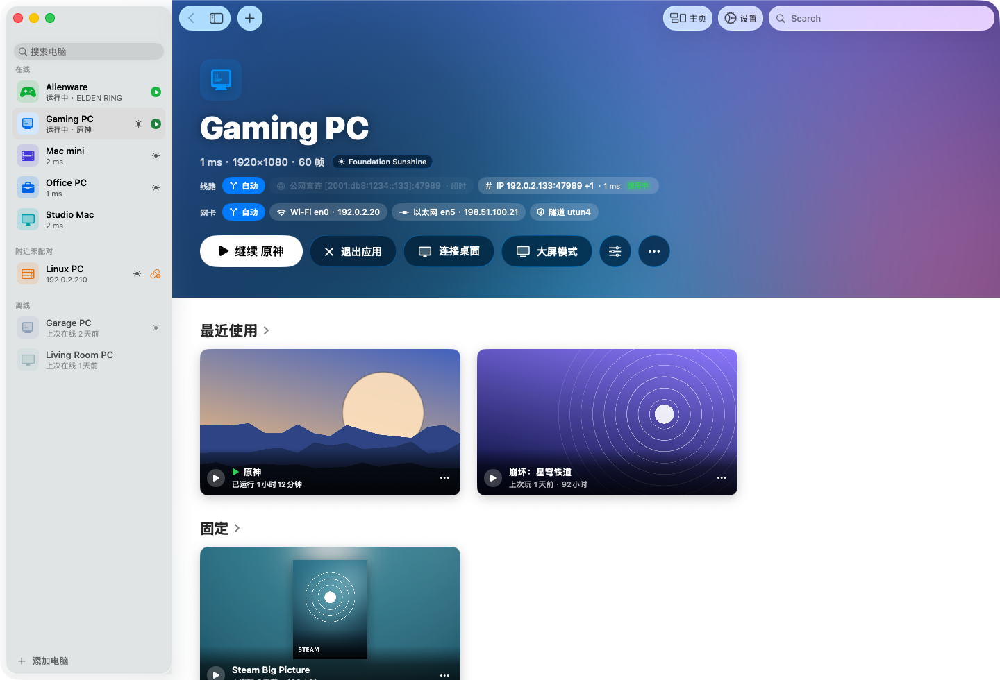
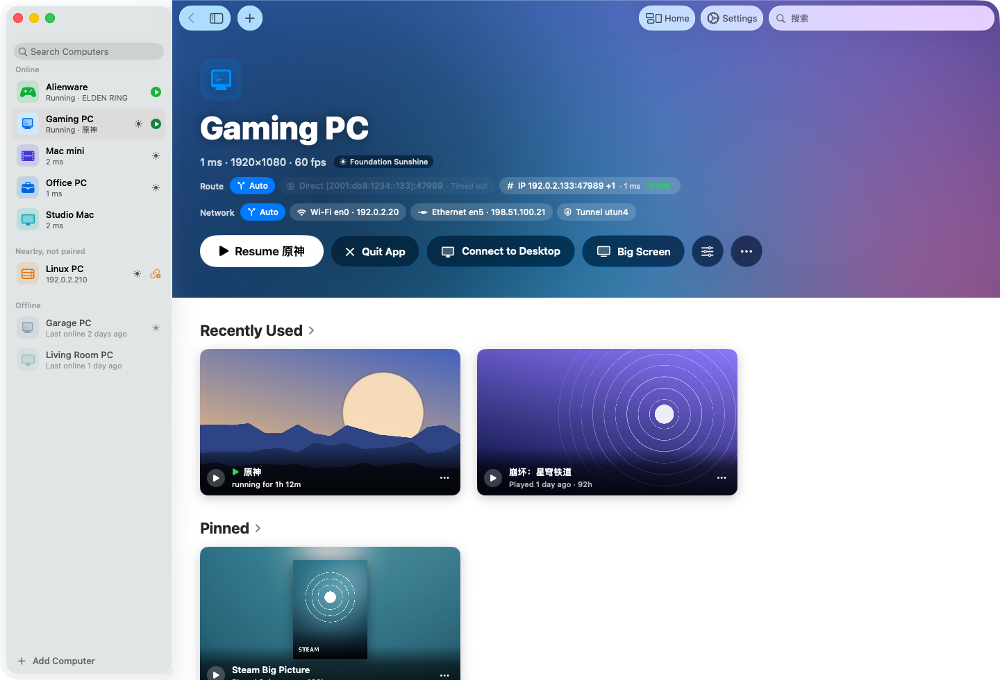

此版本为原生架构重建前最后一个版本。
This is the final release before the native architecture rebuild.

## 全新主界面

主界面重新设计，可个性化调节界面各处细节，提供卡片/大图两种视图，全新支持横版海报（需要最新版 Foundation Sunshine 支持）。

- 在线状态、正在玩的游戏和连接延迟一眼可见，一键继续上次的游戏，连接中可随时取消。
- 大屏模式配合手柄，在沙发上就能浏览、连接和切换电脑。
- 窗口怎么拉都排得整齐，浅色和深色模式全面适配。

<picture>
  <source media="(prefers-color-scheme: dark)" srcset="../../readme-assets/images/home-dark.png">
  
</picture>

## 多线路连接

支持局域网、叠加网络与中继多线路连接，可手动选择线路、查看实测延迟，并为每台电脑指定网卡；应用延迟探测支持 Foundation Sunshine。

## 手柄与触控

全面支持用手柄操作主页与设置，DualSense 无需系统识别也可使用；全新支持触摸屏 Mac 与随航 iPad 多点触控串流。

## 其他改进

- 全新性能浮窗，提供紧凑、角落、曲线三种样式。
- 封面支持原画质无损图，网络空闲时后台下载。
- 连接和串流时暂停后台流量，不再与串流抢带宽。
- DualSense 支持手柄扬声器与耳机音频、静音键、灯光和玩家编号；新增蓝牙触觉与音频（实验性）。
- 界面适配触控，五指按住打开控制中心。
- 与 Foundation Sunshine 同步主机头像、会话和启动模式，带宽探测上限由主机提供。
- 串流核心库同步上游，修复麦克风与内存泄漏问题。
- 设置说明统一为单行，第三方许可证列表更准确。

## 修复

- 修复按住 Control 时 WASD 卡键（[#82](https://github.com/skyhua0224/moonlight-macos-enhanced/issues/82)）。
- 修复连接方式对话框无法关闭（[#81](https://github.com/skyhua0224/moonlight-macos-enhanced/issues/81)）。
- 修复 Windows 键位顺序下 ⌘ 无法持续发送 Alt（[#62](https://github.com/skyhua0224/moonlight-macos-enhanced/issues/62)）。
- 修复 ⌘W 弹出的断开选项无法点击。
- 修复串流重连后的一次崩溃。
- 修复连接随航显示器时无线直连被关闭。
- 修复在运行中的应用上启动另一个应用时，错误恢复原应用。

**需要**：串流中调整码率、主机信息同步与主机带宽上限需要较新版本 Foundation Sunshine；原画质封面与横版海报需要最新版 Foundation Sunshine。

详细变更

#### 连接与后台流量

- 连接线路更清楚：每台电脑有自己的地址簿，线路标签显示地址和实测延迟，并区分局域网、叠加网络与中继；连接按钮旁的“连接方式”可以选择线路。可以为每台电脑固定使用某块网卡（这台电脑的所有串流连接都绑定到这块网卡，失败时不会悄悄改走别的网卡），经代理的线路会有标记。应用延迟探测适用于 Foundation Sunshine。
- 连接和串流期间不再有后台流量：连接中或串流中暂停发现、延迟探测和事件等待；封面下载失败后按退避间隔重试，而不是反复重来（一张 10 MB 的桌面封面曾被一遍遍下载，占满链路，造成连接卡顿）；连接按钮在连接中显示“正在连接…”并带“取消”。
- Foundation Sunshine 主机能力 2：用事件长轮询代替定时刷新（能力 1 的主机仍用安静刷新），主机头像、会话与启动模式随主机同步；带宽探测上限由主机给出，没有时可在高级设置中修改（默认 150 Mbps）。

#### 封面

- 封面图分两级下载：主机支持时先给出小图并立即显示，原画质无损图只在网络空闲时于后台一张一张下载，可从中断处续传，校验通过后才替换小图；连接或串流开始时立刻停止，结束后再继续。旧主机与官方 Sunshine 不受影响。

#### 输入、手柄与触控

- 手柄可以操作主页：焦点环（不会移动页面内容），方向键和左摇杆移动，A 确认，B 返回或取消连接与配对，Menu 键打开所选项目的菜单，LB/RB 切换电脑，右摇杆滚动页面；弹出的表单、提醒和浮窗也可以用手柄操作，关闭后焦点回到原处。DualSense 即使系统没有把它当作手柄，也能通过原始 HID 操作界面。注意：Menu 键现在打开上下文菜单，“设置”改为 Y 键。焦点不会进入电脑列表。按 B 关闭设置窗口后，焦点回到刚才的页面。LT/RT 在主页的各个分区之间跳转，在设置窗口里翻页。
- DualSense 音频与触觉：USB 连接时，主机的扬声器声道可以在手柄扬声器和耳机上播放，触觉仍由分析后的触觉帧驱动 Core Haptics；蓝牙连接新增实验性的触觉与音频通路，以及输出报告速率上限设置。还新增静音键发送、主机灯光与音频控制、玩家编号，串流中接入的手柄会被自动识别。
- 新增触控：带触摸屏的 Mac 和 Sidecar 的 iPad 可以直接多点触控串流（设置中的“触控方式”），应用页面和串流菜单球适配触控（36 pt 点击区域、长按菜单），五指按住打开控制中心。
- 修复按住 Control 的 WASD 在主机上只按下不抬起（[#82](https://github.com/skyhua0224/moonlight-macos-enhanced/issues/82)）、连接方式对话框无法关闭（[#81](https://github.com/skyhua0224/moonlight-macos-enhanced/issues/81)）、Windows 键位顺序下按住 ⌘ 不持续发送 Alt（[#62](https://github.com/skyhua0224/moonlight-macos-enhanced/issues/62)）；⌘W 弹出的断开选项可以点击。

#### 性能浮窗与界面

- 新增性能浮窗（紧凑、角落、曲线三种样式），有自己的设置页和实时预览。
- 设置页的说明文字都限制为一行（按实际渲染检查）；第三方许可证窗口按应用包里实际包含的内容重新生成。

#### 串流核心库

- 串流核心库（moonlight-common-c）同步到上游 mic 主线：串流地址刷新、协议扩展注册表、麦克风 PKCS7 填充修复、按键通道 UTF-8、控制流原地加密、RTSP 解析器重写，以及重复 RTSP 选项的内存泄漏和 ping 载荷未初始化数据的修复。串流中调整码率的主机回调改用新的功能位 0x4000，需要配套的 Foundation Sunshine 版本。

#### 稳定性

- 稳定性：串流重连后，健康检查计时器不再访问已释放的会话；连接了 Sidecar 显示器时，AWDL 稳定辅助程序不再关闭 awdl0；在已运行的应用上启动另一个应用时不再恢复正在运行的那个。

---

## A new main window

The main window has been redesigned. You can fine-tune the details of the interface, switch between Card and Big Picture views, and use the new landscape posters (requires the latest Foundation Sunshine).

- See at a glance whether a computer is online, what is running and how fast the connection is, pick up your last game in one click, and cancel at any time while connecting.
- Big Screen mode and controller support let you browse, connect and switch computers from the couch.
- Clean layouts at any window size, in light and dark mode.

<picture>
  <source media="(prefers-color-scheme: dark)" srcset="../../readme-assets/images/en/home-dark.png">
  
</picture>

## Multi-path connections

Connect over LAN, overlay networks or relays, pick a path by hand, see its measured latency, and pin each computer to a network interface. The application latency probe now works with Foundation Sunshine.

## Controllers and touch

Full controller support for the home page and Settings, and a DualSense works even when macOS does not see it as a controller. New: direct multi-touch streaming on touchscreen Macs and Sidecar iPads.

## More improvements

- New performance HUD in compact, corner and chart styles.
- Lossless posters, downloaded in the background while the network is idle.
- Background traffic pauses while you connect or stream, so it no longer competes with the stream.
- DualSense: pad speaker and headset audio, the Mute button, light and player numbers; Bluetooth haptics and audio (experimental).
- Touch-friendly interface; hold five fingers to open the Control Center.
- Host avatar, session and launch mode sync with Foundation Sunshine, and the host sets the bandwidth probe ceiling.
- Streaming core synced with upstream, with microphone and memory leak fixes.
- One-line setting descriptions and a more accurate third-party licenses list.

## Fixes

- Fixed WASD sticking while Control is held ([#82](https://github.com/skyhua0224/moonlight-macos-enhanced/issues/82)).
- Fixed the connection method dialog not closing ([#81](https://github.com/skyhua0224/moonlight-macos-enhanced/issues/81)).
- Fixed ⌘ not sending Alt continuously in Windows key order ([#62](https://github.com/skyhua0224/moonlight-macos-enhanced/issues/62)).
- Fixed the disconnect options opened with ⌘W not being clickable.
- Fixed a crash after a stream reconnect.
- Fixed peer-to-peer Wi-Fi being turned off while a Sidecar display is connected.
- Fixed starting an app over a running one resuming the old app.

**Requirements:** changing the bitrate mid-stream, host info sync and the host bandwidth ceiling need a recent Foundation Sunshine; lossless posters and landscape posters need the latest Foundation Sunshine.

Detailed changes

#### Connection and background traffic

- Clearer connection paths: each computer has an address book, path chips show the address and the measured latency and tell LAN, overlay and relay apart, and the connection menu next to the connect button picks a path. A computer can be pinned to one network interface (every stream socket of that computer is bound to it and a failure never falls back to another one), and paths through a proxy are marked. The application latency probe works against Foundation Sunshine.
- No background traffic while connecting or streaming: discovery, latency probes and event waits pause while a connection is pending or a stream is open; failed poster downloads back off instead of starting over (a 10 MB desktop poster had been fetched again and again, filling the link and making connections stall); the connect button shows “Connecting…” with Cancel while connecting.
- Foundation Sunshine host capability 2: an event long-poll replaces timed refreshes (hosts at capability 1 keep the quiet refresh), and the host avatar, session and launch mode follow the host; the bandwidth probe ceiling comes from the host when it states one, otherwise it is an advanced setting (150 Mbps by default).

#### Posters

- Posters now come in two tiers: on a host that supports it a small preview is shown at once, and the lossless picture is downloaded later, only while the network is idle, one at a time in the background, resumed where it stopped and swapped in only after it has been verified. It stops the moment a connection or stream starts and resumes after it ends. Older hosts and stock Sunshine are unchanged.

#### Input, controllers and touch

- The gamepad now operates the home page: a focus ring that moves nothing in the page, the D-pad and left stick to move, A to activate, B to go back or cancel a connection or pairing, the Menu button for the menu of the selected item, LB/RB to switch computers and the right stick to scroll; sheets, alerts and popovers work with the pad too, and focus returns where it was when they close. A DualSense that macOS does not report as a game controller can still drive the interface through raw HID. Note: the Menu button now opens the context menu, and Settings moved to Y. Focus never enters the computer list. Pressing B closes the settings window, and focus returns to the page you were on. LT/RT jumps between sections of the home page and turns pages in Settings.
- DualSense audio and haptics: over USB the host's speaker channels can play on the pad speaker and headset, with haptics still driven by analysed frames through Core Haptics; over Bluetooth there is an experimental haptics and audio path and an output report rate cap. Also added: the Mute button, host light and audio controls and player numbers; pads that connect during a stream are picked up.
- Added touch: touchscreen Macs and a Sidecar iPad can stream with direct multi-touch (the Touch Mode setting), the app pages and the stream menu ball are touch friendly (36 pt targets, long-press menus), and holding five fingers opens the Control Center.
- Fixed Control+WASD sending only the key down on the host (#82), the connection method dialog not closing (#81), and ⌘ held in Windows key order not sending Alt continuously (#62); the disconnect options opened with ⌘W can be clicked.

#### Performance HUD and interface

- Added a performance HUD (compact, corner and chart styles) with its own settings page and a live preview.
- Setting descriptions are limited to one line (checked by rendering them); the third-party licenses window is rebuilt from what is really in the app bundle.

#### Streaming core

- The streaming core (moonlight-common-c) is synced to the upstream mic line: endpoint refresh, the protocol extension registry, the microphone PKCS7 padding fix, UTF-8 on the keyboard channel, in-place control stream encryption, the RTSP parser rework, and fixes for a memory leak on duplicate RTSP options and uninitialized data in the ping payload. The host callback for changing the bitrate mid-stream now uses the new feature bit 0x4000 and needs a matching Foundation Sunshine build.

#### Stability

- Stability: after a stream reconnect the stream health timer no longer reaches a freed session; the AWDL stability helper no longer brings awdl0 down while a Sidecar display is connected; starting an app over a running one no longer resumes the running one.

