1.3.9 是原生架构重建前最后一个版本。建议配合基地官方推荐的 [Foundation Sunshine](https://github.com/AlkaidLab/foundation-sunshine/releases/latest) 使用。
1.3.9 is the last version before the native-architecture rebuild. We recommend using it with [Foundation Sunshine](https://github.com/AlkaidLab/foundation-sunshine/releases/latest), the host recommended by AlkaidLab.

如果觉得好用，欢迎给项目点一个 Star。
If you like it, please give the project a Star.

## 全新主界面与宽广兼容 | New main window and broad compatibility

主界面与设置全面重设计，可个性化调节界面各处细节，提供卡片与大图两种视图，全新支持横版海报（需要最新版 Foundation Sunshine 支持），并完整支持 macOS 12 至 26。
The main window and settings have been fully redesigned, with details you can personalize throughout. Offers card and large-artwork views, adds support for landscape posters (needs the latest Foundation Sunshine), and fully supports macOS 12 to 26.

<picture><source media="(prefers-color-scheme: dark) and (max-width: 600px)" srcset="https://raw.githubusercontent.com/skyhua0224/moonlight-macos-enhanced/master/readme-assets/release/1.3.9/mlsu-ui-p-dark.webp"><source media="(max-width: 600px)" srcset="https://raw.githubusercontent.com/skyhua0224/moonlight-macos-enhanced/master/readme-assets/release/1.3.9/mlsu-ui-p.webp"><source media="(prefers-color-scheme: dark)" srcset="https://raw.githubusercontent.com/skyhua0224/moonlight-macos-enhanced/master/readme-assets/release/1.3.9/mlsu-ui-d-dark.webp"></picture>

<table>
<tr>
<td width="50%" valign="top">

<picture>
  <source media="(prefers-color-scheme: dark)" srcset="https://raw.githubusercontent.com/skyhua0224/moonlight-macos-enhanced/master/readme-assets/images/home-dark.png">
  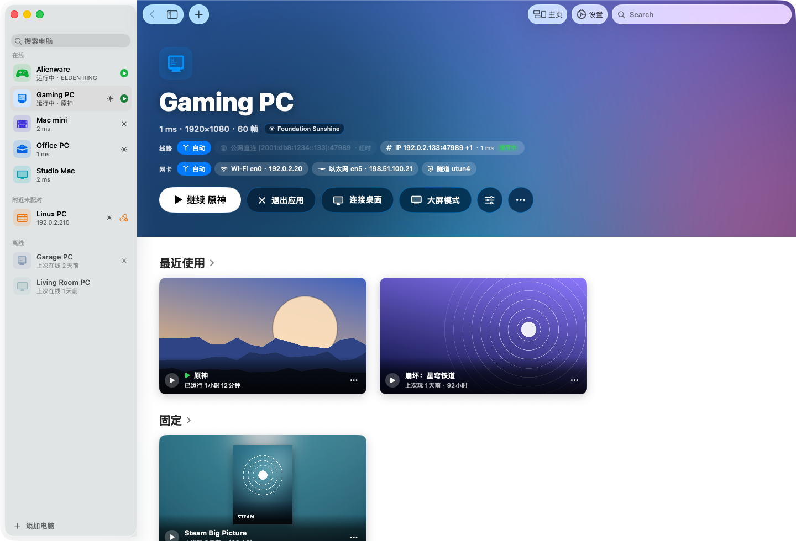
</picture>

<b>主界面 | Main window</b>

</td>
<td width="50%" valign="top">

<picture>
  <source media="(prefers-color-scheme: dark)" srcset="https://raw.githubusercontent.com/skyhua0224/moonlight-macos-enhanced/master/readme-assets/images/home-portrait-dark.png">
  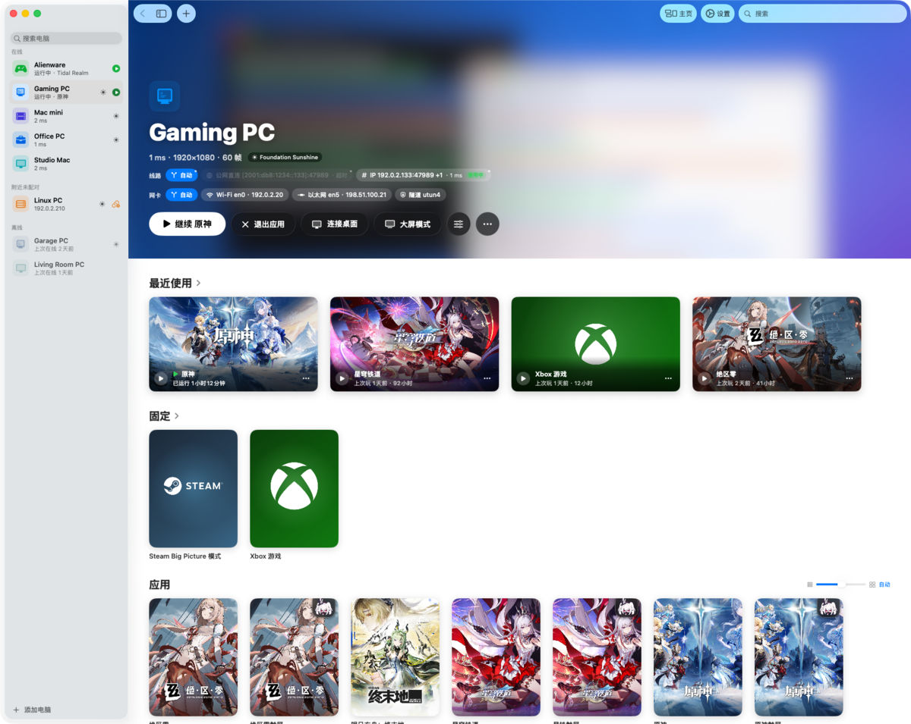
</picture>

<b>大图视图 | Large-artwork view</b>

</td>
</tr>
</table>

<b>详细功能 | Details</b>

- 支持一眼查看电脑在线状态、正在运行的应用与连接延迟，可一键继续上次的游戏并在连接过程中随时取消。
  Supports seeing at a glance whether your PC is online, which app is running and the connection latency, resuming the last game in one click, and cancelling at any time while connecting.
- 支持使用大图视图与手柄从沙发上浏览、连接并切换电脑，支持通过设置开关随时切回经典主页。
  Supports browsing, connecting and switching PCs from the couch with the large-artwork view and a controller, and switching back to the classic home page with a setting at any time.
- 支持无主机页面自动发现局域网内电脑并在探测就绪后平滑进入列表，全面适配浅色、深色模式与任意窗口尺寸。
  Supports an empty-state page that discovers PCs on your local network automatically and moves smoothly into the list once the probe is ready, and fully adapts to light and dark mode and any window size.
- 支持直接打开应用卡片或磁贴的右键菜单，正在运行应用的「退出应用」位于「置顶 / 隐藏」下方（[#109](https://github.com/skyhua0224/moonlight-macos-enhanced/issues/109)）。
  Supports opening the right-click menu of an app card or tile directly; "Quit App" for the running app sits right under "Pin / Hide" ([#109](https://github.com/skyhua0224/moonlight-macos-enhanced/issues/109)).

## 多线路连接与主机协同 | Multi-route connections and host collaboration

支持局域网、叠加网络与中继多线路连接，可手动选择线路、查看实测延迟，并为每台电脑指定网卡；连接与串流期间自动暂停后台流量。
Supports local-network, overlay-network and relay routes. You can pick a route by hand, see the measured latency and choose the network adapter for each PC; background traffic pauses automatically during connecting and streaming.

<picture><source media="(prefers-color-scheme: dark) and (max-width: 600px)" srcset="https://raw.githubusercontent.com/skyhua0224/moonlight-macos-enhanced/master/readme-assets/release/1.3.9/mlsu-link-p-dark.webp"><source media="(max-width: 600px)" srcset="https://raw.githubusercontent.com/skyhua0224/moonlight-macos-enhanced/master/readme-assets/release/1.3.9/mlsu-link-p.webp"><source media="(prefers-color-scheme: dark)" srcset="https://raw.githubusercontent.com/skyhua0224/moonlight-macos-enhanced/master/readme-assets/release/1.3.9/mlsu-link-d-dark.webp">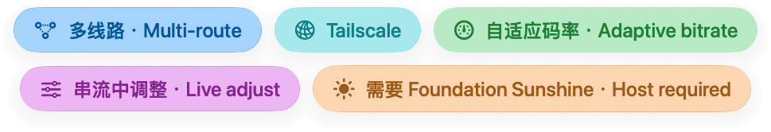</picture>

<b>详细功能 | Details</b>

- 支持与 Foundation Sunshine 同步主机头像、会话状态、启动模式与带宽探测上限，并支持在串流中随时调整码率、帧率、分辨率与自由窗口尺寸（需要最新版 Foundation Sunshine 支持）。
  Supports syncing the host avatar, session state, launch mode and bandwidth-probe limit with Foundation Sunshine, and adjusting bitrate, frame rate, resolution and free window size at any time during a stream (needs the latest Foundation Sunshine).
- 支持应用延迟探测与 Tailscale 状态检测（可在设置中开关），后台探测不干扰前台体验且不自动拉起额外应用窗口。
  Supports app latency probing and Tailscale status detection (switchable in settings); background probes do not disturb the foreground and never launch extra app windows on their own.
- 支持自适应码率、串流前带宽探测，以及从旧版升级后保留“输入监控”授权并在缺失时引导前往系统设置（从更早版本首次升级需再授权一次）。
  Supports adaptive bitrate, a bandwidth probe before streaming, and keeping the "Input Monitoring" grant when upgrading from an earlier version, guiding you to System Settings when it is missing (upgrading from an older version needs one more grant).

## 手柄、音频与触控输入 | Controllers, audio and touch input

全面支持用手柄操作主页、设置与控制中心，增强 DualSense 音频与触觉，新增参数均衡器、空间音频与多点触控串流。
Fully supports operating the home page, settings and Control Center with a controller. Enhances DualSense audio and haptics, and adds a parametric equalizer, spatial audio and multi-touch streaming.

<picture><source media="(prefers-color-scheme: dark) and (max-width: 600px)" srcset="https://raw.githubusercontent.com/skyhua0224/moonlight-macos-enhanced/master/readme-assets/release/1.3.9/mlsu-input-p-dark.webp"><source media="(max-width: 600px)" srcset="https://raw.githubusercontent.com/skyhua0224/moonlight-macos-enhanced/master/readme-assets/release/1.3.9/mlsu-input-p.webp"><source media="(prefers-color-scheme: dark)" srcset="https://raw.githubusercontent.com/skyhua0224/moonlight-macos-enhanced/master/readme-assets/release/1.3.9/mlsu-input-d-dark.webp"></picture>

<table>
<tr>
<td width="50%" valign="top">

<picture>
  <source media="(prefers-color-scheme: dark)" srcset="https://raw.githubusercontent.com/skyhua0224/moonlight-macos-enhanced/master/readme-assets/images/settings-controller-dark.png">
  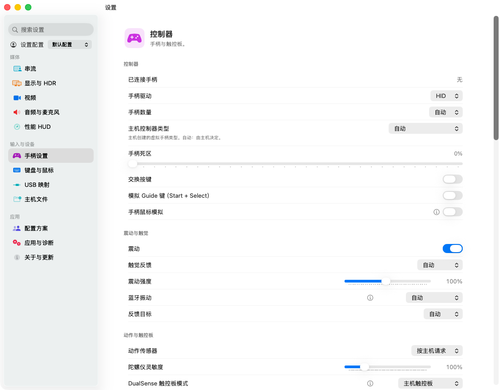
</picture>

<b>手柄设置 | Controller settings</b>

</td>
<td width="50%" valign="top">

<picture>
  <source media="(prefers-color-scheme: dark)" srcset="https://raw.githubusercontent.com/skyhua0224/moonlight-macos-enhanced/master/readme-assets/images/settings-audio-dark.png">
  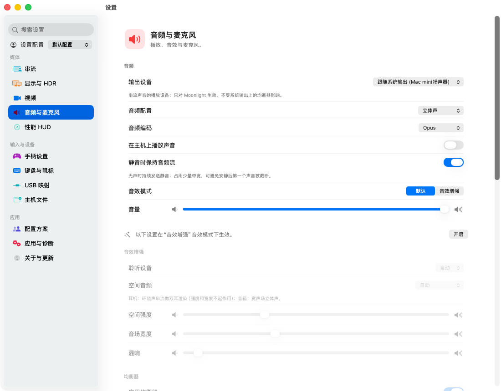
</picture>

<b>音频与麦克风 | Audio and microphone</b>

</td>
</tr>
</table>

<b>详细功能 | Details</b>

- 全新支持触摸屏 Mac 与随航 iPad 直接多点触控串流，界面适配触控操作并支持五指按住打开控制中心。
  Adds support for direct multi-touch streaming on touch-screen Macs and Sidecar iPad, with a touch-friendly interface and a five-finger hold to open the Control Center.
- 全新支持无线与有线场景下的精确式触控板手势、macOS 输入法直接输入文字，以及直接读取物理 Caps Lock 发送至主机（默认关闭，需要“输入监控”权限；[#108](https://github.com/skyhua0224/moonlight-macos-enhanced/issues/108)）。
  Adds support for precise trackpad gestures over wireless and wired connections, typing text directly with macOS input methods, and sending the physical Caps Lock straight to the host (off by default, needs "Input Monitoring" permission; [#108](https://github.com/skyhua0224/moonlight-macos-enhanced/issues/108)).
- 支持 DualSense 无需系统识别即可操作界面，并支持手柄扬声器与耳机音频、静音键、灯光、玩家编号与实验性蓝牙触觉及音频。
  Supports operating the interface with a DualSense without the system recognizing it, plus controller speaker and headset audio, the mute button, lights, player numbers and experimental Bluetooth haptics and audio.
- 全新支持参数均衡器（含 6000 余款耳机实测预设库）、耳机双耳空间音频，以及无损 PCM、AC3 与 E-AC3 编码（需要 Foundation Sunshine 支持），并支持无硬件解码的 Mac 选用软件 AV1。
  Adds support for a parametric equalizer (with a library of 6,000+ measured headphone presets), binaural spatial audio for headphones, and lossless PCM, AC3 and E-AC3 encoding (needs Foundation Sunshine), and lets Macs without hardware decoding use software AV1.

## 其他改进 | More improvements

<picture><source media="(prefers-color-scheme: dark) and (max-width: 600px)" srcset="https://raw.githubusercontent.com/skyhua0224/moonlight-macos-enhanced/master/readme-assets/release/1.3.9/mlsu-video-p-dark.webp"><source media="(max-width: 600px)" srcset="https://raw.githubusercontent.com/skyhua0224/moonlight-macos-enhanced/master/readme-assets/release/1.3.9/mlsu-video-p.webp"><source media="(prefers-color-scheme: dark)" srcset="https://raw.githubusercontent.com/skyhua0224/moonlight-macos-enhanced/master/readme-assets/release/1.3.9/mlsu-video-d-dark.webp">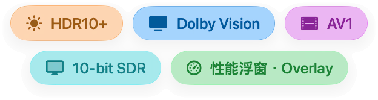</picture>

- 全新支持紧凑、角落、曲线三种样式的性能浮窗与实时预览，帧率与丢包读数保持准确稳定。
  Adds compact, corner and curve performance overlay styles with a live preview, with steady and accurate frame-rate and packet-loss readings.
- 全新支持设置页面搜索、配置方案对比预设与导入导出，以及连接和串流过程中的性能诊断导出。
  Adds settings search, setting-profile comparison, presets and import/export, and performance diagnostics export for connecting and streaming.
- 可大幅减小安装包体积（Apple 芯片版 11.9 MB → 6.3 MB）并显著降低加密串流解密的 CPU 占用。
  Makes the download much smaller (Apple silicon: 11.9 MB → 6.3 MB) and cuts the CPU used to decrypt encrypted streams significantly.

<table>
<tr>
<td width="50%" valign="top">

<picture>
  <source media="(prefers-color-scheme: dark)" srcset="https://raw.githubusercontent.com/skyhua0224/moonlight-macos-enhanced/master/readme-assets/images/hud-chartHUD-dark.png">
  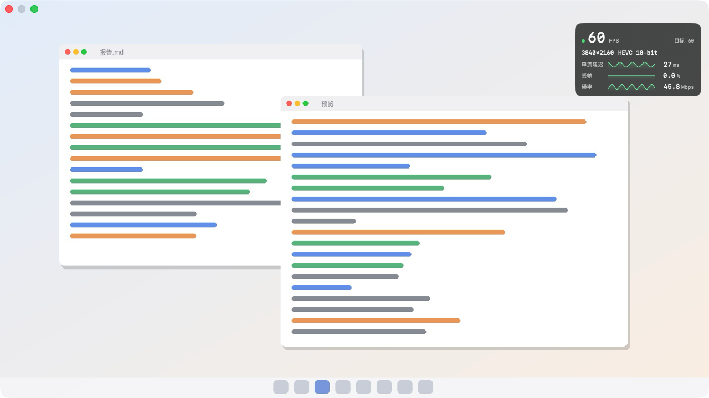
</picture>

<b>性能浮窗 | Performance overlay</b>

</td>
<td width="50%" valign="top">

<picture>
  <source media="(prefers-color-scheme: dark)" srcset="https://raw.githubusercontent.com/skyhua0224/moonlight-macos-enhanced/master/readme-assets/images/search-dark.png">
  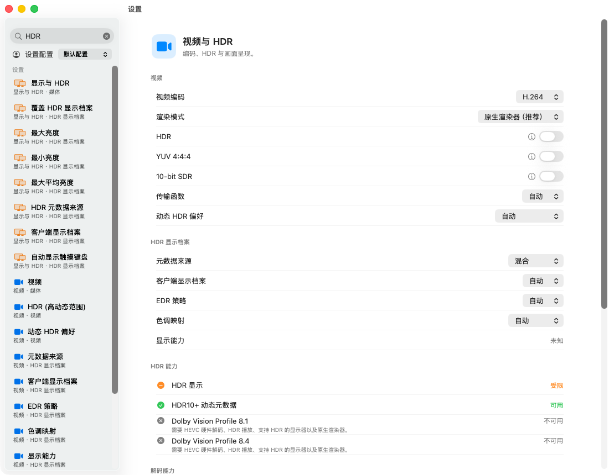
</picture>

<b>设置搜索 | Settings search</b>

</td>
</tr>
</table>

截图里的电脑名和地址是示例，游戏封面归其版权方所有。
Computer names and addresses in the screenshots are examples; game covers belong to their owners.

<b>更多改进 | 5 more</b>

- 支持原画质无损封面在网络空闲时后台断点下载，串流或连接时自动让路。
  Supports background, resumable downloads of full-quality lossless covers while the network is idle, stepping aside while streaming or connecting.
- 支持在独立 10-bit SDR、动态 HDR 偏好（Dolby Vision 8.1/8.4、HDR10+）与无边框全屏避让刘海之间自由选择。
  Supports choosing freely between standalone 10-bit SDR, dynamic HDR preferences (Dolby Vision 8.1/8.4, HDR10+) and borderless full screen that avoids the notch.
- 支持捕获系统快捷键并发送给主机（需要辅助功能权限），新增 Windows 键位顺序切换与快速键入剪贴板文本快捷键。
  Supports capturing system shortcuts and sending them to the host (needs Accessibility permission), and adds a Windows key-order switch and a quick shortcut to type clipboard text.
- 支持统一规范的中英文界面文案与单行设置说明，第三方许可证列表与实际打包内容保持一致。
  Supports consistent Chinese and English interface text with single-line setting descriptions, and keeps the third-party license list in line with what is actually packaged.
- 需要：串流中调整码率、帧率、分辨率、自由窗口、新增音频编码、主机信息同步与主机带宽上限需要较新版本的基地官方推荐的 Foundation Sunshine；原画质封面与横版海报需要最新版。
  Requires: adjusting bitrate, frame rate and resolution during a stream, the free window, the new audio codecs, host information sync and the host bandwidth limit need a recent version of Foundation Sunshine, the host recommended by AlkaidLab; full-quality covers and landscape posters need the latest version.

## 修复 | Fixes

- 修复未授权“输入监控”时自由鼠标来回抖动的问题，并让光标移动更平滑跟手（[#87](https://github.com/skyhua0224/moonlight-macos-enhanced/issues/87)）。
  Fixed the cursor jittering back and forth in free mouse mode without Input Monitoring access, and made the cursor move more smoothly ([#87](https://github.com/skyhua0224/moonlight-macos-enhanced/issues/87)).
- 修复同时开启自动 FEC、自动码率等选项时无法连接主机，以及连接失败时一直停在加载画面不显示原因的问题。
  Fixed failing to connect when automatic FEC, automatic bitrate and similar options were on together, and staying on the loading screen without a reason when a connection failed.
- 修复原生渲染器下 SDR 画面偏暗、与主机画面颜色不一致的问题（[#123](https://github.com/skyhua0224/moonlight-macos-enhanced/issues/123)）。
  Fixed SDR streams looking darker than on the host with the native renderer ([#123](https://github.com/skyhua0224/moonlight-macos-enhanced/issues/123)).
- 修复长按方向键、导航键或 F1–F12 时持续重复发送松开事件的问题（[#111](https://github.com/skyhua0224/moonlight-macos-enhanced/issues/111)）。
  Fixed continuous key-up events being sent while holding arrow keys, navigation keys or F1–F12 ([#111](https://github.com/skyhua0224/moonlight-macos-enhanced/issues/111)).

<b>全部修复 | 7 more fixes</b>

- 修复按住 Control 时 WASD 卡键的问题（[#82](https://github.com/skyhua0224/moonlight-macos-enhanced/issues/82)）。
  Fixed WASD keys sticking while Control is held ([#82](https://github.com/skyhua0224/moonlight-macos-enhanced/issues/82)).
- 修复 Windows 键位顺序下 ⌘ 无法持续发送 Alt 的问题（[#62](https://github.com/skyhua0224/moonlight-macos-enhanced/issues/62)）。
  Fixed ⌘ not holding Alt in Windows key order ([#62](https://github.com/skyhua0224/moonlight-macos-enhanced/issues/62)).
- 修复无边框、悬浮或普通串流窗口下按 ⌘W 弹出的断开选项与连接方式对话框无法点击或关闭的问题（[#81](https://github.com/skyhua0224/moonlight-macos-enhanced/issues/81)）。
  Fixed the disconnect options and connection-method dialog shown by ⌘W being unclickable or impossible to close in borderless, floating or normal stream windows ([#81](https://github.com/skyhua0224/moonlight-macos-enhanced/issues/81)).
- 修复输出至 HDMI 电视等设备或装有虚拟音频设备时开始或结束串流可能卡死或崩溃的问题。
  Fixed stream start or end possibly hanging or crashing when outputting to an HDMI TV or when a virtual audio device is installed.
- 修复串流重连后、切换分辨率或帧率后部分显示设置重置，以及在已运行应用上启动其他应用时错误恢复原应用的问题。
  Fixed some display settings resetting after a stream reconnect or a resolution or frame-rate change, and the original app being wrongly restored when another app is launched over a running one.
- 修复连接随航显示器时无线直连（AWDL）被关闭，以及关闭串流后程序坞菜单残留不可见窗口的问题（[#69](https://github.com/skyhua0224/moonlight-macos-enhanced/pull/69)）。
  Fixed AWDL being turned off when connecting to a Sidecar display, and invisible windows lingering in the Dock menu after a stream closes ([#69](https://github.com/skyhua0224/moonlight-macos-enhanced/pull/69)).
- 修复 macOS 12–14 上开始串流崩溃或分辨率选择器不可用、按应用指定的显示器第二次启动才生效，以及日志查看器本地化异常的问题（[#26](https://github.com/skyhua0224/moonlight-macos-enhanced/issues/26)、[#30](https://github.com/skyhua0224/moonlight-macos-enhanced/issues/30)、[#61](https://github.com/skyhua0224/moonlight-macos-enhanced/issues/61)）。
  Fixed a crash when starting a stream or an unusable resolution picker on macOS 12–14, a per-app display that only took effect on the second launch, and broken localization in the log viewer ([#26](https://github.com/skyhua0224/moonlight-macos-enhanced/issues/26), [#30](https://github.com/skyhua0224/moonlight-macos-enhanced/issues/30), [#61](https://github.com/skyhua0224/moonlight-macos-enhanced/issues/61)).

## 安装指引 | Installation guide

**第 1 步 · 下载**：在下方下载 `Moonlight-macOS-Enhanced-universal.dmg`，不确定就选 `universal`。
**Step 1 · Download**: download `Moonlight-macOS-Enhanced-universal.dmg` below; pick `universal` if unsure.

<picture><source media="(prefers-color-scheme: dark)" srcset="https://raw.githubusercontent.com/skyhua0224/moonlight-macos-enhanced/master/readme-assets/images/sections/install-1-download-zh-dark.webp">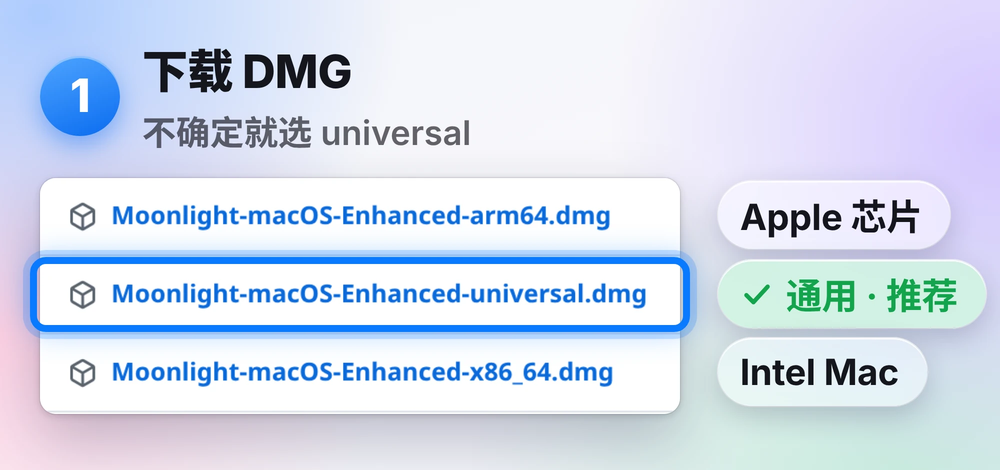</picture>

<b>第 2–4 步：安装、首次启动、输入监控 | Steps 2–4: install, first launch, Input Monitoring</b>

**第 2 步 · 安装**：打开 DMG，把 `MoonlightEnhanced.app` 拖到“应用程序”。
**Step 2 · Install**: open the DMG and drag `MoonlightEnhanced.app` to Applications.

<picture><source media="(prefers-color-scheme: dark)" srcset="https://raw.githubusercontent.com/skyhua0224/moonlight-macos-enhanced/master/readme-assets/images/sections/install-2-dmg-zh-dark.webp">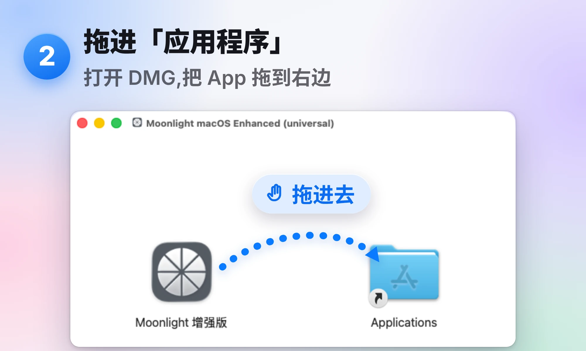</picture>

**第 3 步 · 首次启动**：右键应用选择“打开”，或前往 `系统设置 → 隐私与安全性` 选择“仍要打开”。仍被拦截时见下方「应用已损坏」中的终端命令。
**Step 3 · First launch**: right-click the app and choose `Open`, or go to `System Settings → Privacy & Security` and click `Open Anyway`. If it is still blocked, use the Terminal command under "If macOS says the app is damaged" below.

<picture><source media="(prefers-color-scheme: dark)" srcset="https://raw.githubusercontent.com/skyhua0224/moonlight-macos-enhanced/master/readme-assets/images/sections/install-3-gatekeeper-zh-dark.webp">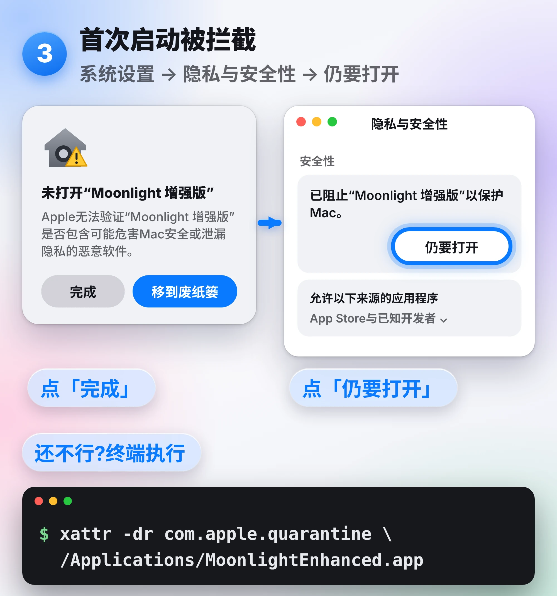</picture>

**第 4 步 · 输入监控**：应用提示时，在 `系统设置 → 隐私与安全性 → 输入监控` 中打开开关，以启用 CoreHID。
**Step 4 · Input Monitoring**: when the app asks, switch on `System Settings → Privacy & Security → Input Monitoring` to enable CoreHID.

<picture><source media="(prefers-color-scheme: dark)" srcset="https://raw.githubusercontent.com/skyhua0224/moonlight-macos-enhanced/master/readme-assets/images/sections/install-4-input-monitoring-zh-dark.webp">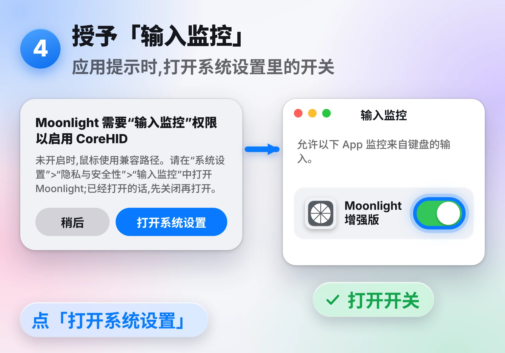</picture>

