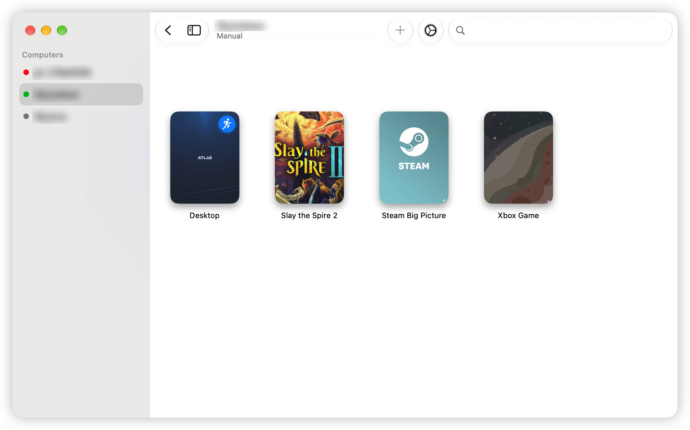
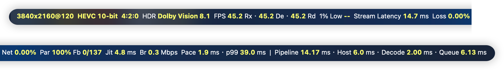
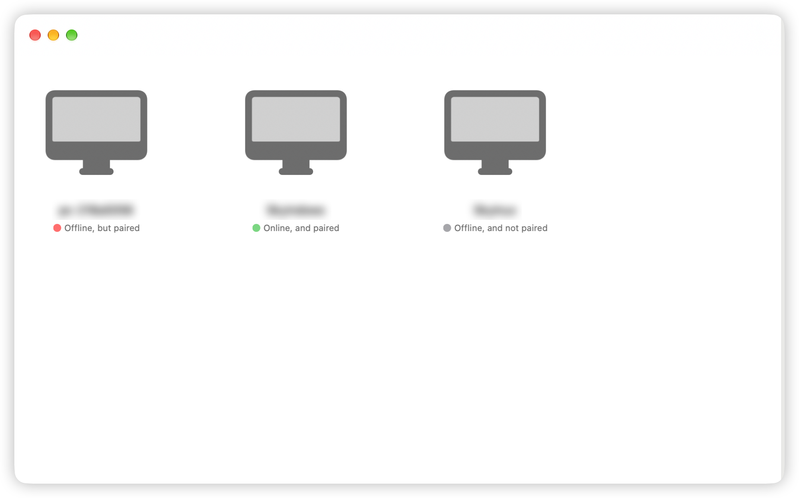
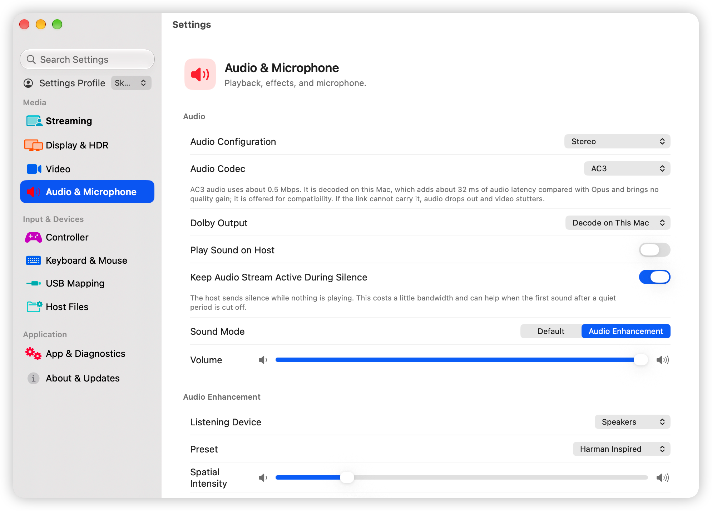
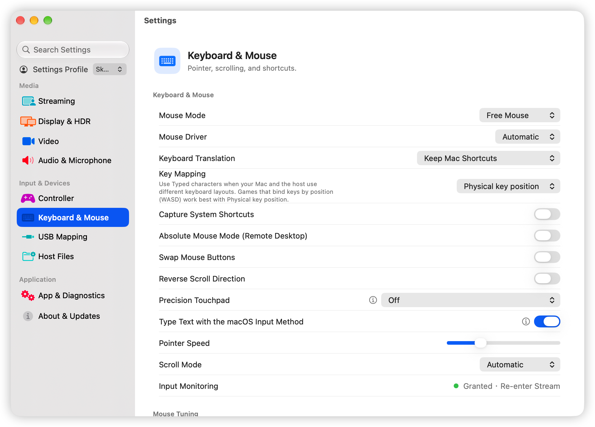
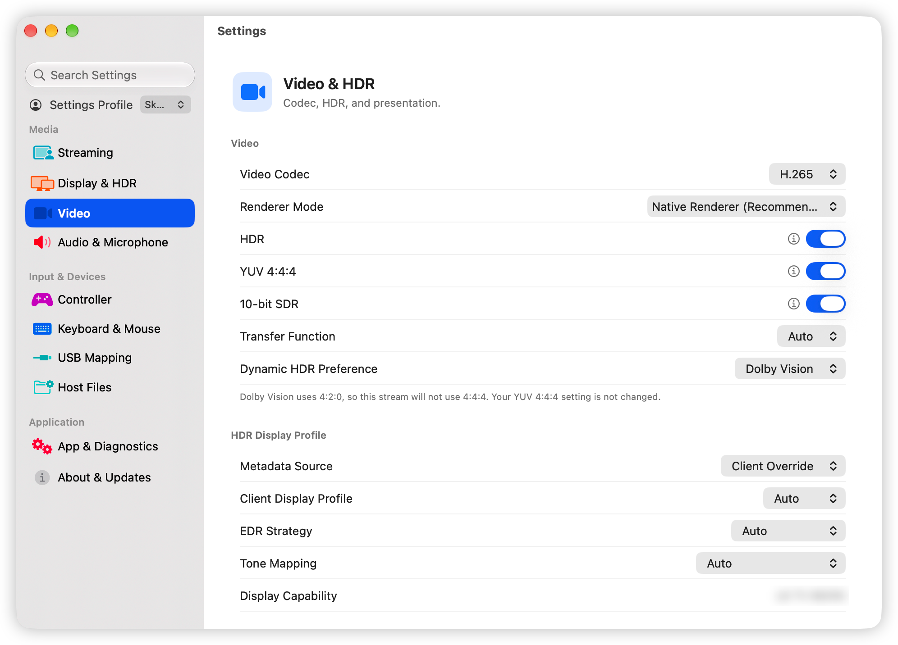

# Moonlight macOS Enhanced

<div align="center">

[](https://github.com/skyhua0224/moonlight-macos-enhanced/actions/workflows/build.yml) [](https://github.com/skyhua0224/moonlight-macos-enhanced/releases) [](https://github.com/skyhua0224/moonlight-macos-enhanced/releases) [](https://github.com/skyhua0224/moonlight-macos-enhanced/releases) [](LICENSE.txt)

**Native Moonlight macOS / Moonlight for macOS Client**

`Moonlight macOS Enhanced` is a native macOS streaming client for Sunshine, Foundation Sunshine, and compatible GameStream hosts. It is built with AppKit / SwiftUI, runs on Apple Silicon and Intel Macs, and requires macOS 12 or later.

[简体中文](README.md) | English

[Download](https://github.com/skyhua0224/moonlight-macos-enhanced/releases) · [Release notes](.github/release-notes/v1.3.9-rc.4.md) · [Report an issue](https://github.com/skyhua0224/moonlight-macos-enhanced/issues)



</div>

**Contents**: [Current Release](#current-release) · [Quick Start](#quick-start) · [Features](#features) · [Screenshots](#screenshots) · [Host Compatibility](#host-compatibility) · [Installation](#installation) · [Video and HDR](#video-and-hdr) · [Audio](#audio) · [Keyboard, Mouse, and Trackpad](#keyboard-mouse-and-trackpad) · [Controllers](#controllers) · [Control Center](#in-stream-control-center) · [Foundation Sunshine Integration](#foundation-sunshine-integration) · [Connectivity and Diagnostics](#connectivity-and-diagnostics) · [Updates](#updates) · [Build from Source](#build-from-source) · [Reporting Issues](#reporting-issues)

## Current Release

The latest release is **1.3.9 RC4** (prerelease); see the [1.3.9 RC4 release notes](.github/release-notes/v1.3.9-rc.4.md) for what changed. 1.3.9 is the final release before the native architecture rebuild.

- Download it from [Releases](https://github.com/skyhua0224/moonlight-macos-enhanced/releases). Packages come as `universal`, `arm64`, and `x86_64`; choose `universal` if unsure.
- If 1.3.9 is already installed, check for updates in `Settings → About & Updates`.
- If macOS blocks the first launch, see Installation below.

What changed in 1.3.9 compared with 1.3.8:

- Settings were redesigned and can be searched down to individual options; the whole app can be driven with a controller.
- Audio gained lossless PCM, AC3, E-AC3, and Dolby passthrough, and the output device can be switched during a stream; Audio Enhancement gained a parametric equalizer, headphone correction presets, and binaural surround on headphones.
- Input gained Precision Touchpad, text entry through macOS input methods, and key mapping by typed character; DualSense supports its touchpad, lighting, battery, and haptics.
- Video gained a separate 10-bit SDR option, a Dynamic HDR Preference, and Dolby Vision and HDR10+ negotiation with fallback; Macs without an AV1 hardware decoder can decode AV1 in software.
- With Foundation Sunshine: display and virtual display configuration, bitrate, frame rate, and resolution changes without reconnecting, adaptive bitrate, host display scale, and Host Commands.
- Added in-app updates, performance report export, and a bilingual log viewer.

## Quick Start

1. Install and run [Foundation Sunshine](https://github.com/AlkaidLab/foundation-sunshine) or [Sunshine](https://github.com/LizardByte/Sunshine) on the computer you want to stream from.
2. Install this app on the Mac and open it. Allow Local Network access on first launch; hosts on the same network appear automatically, or add a host address manually.
3. Click a host to pair: the app shows a PIN, which you enter in the host's Sunshine web interface.
4. Once paired, choose an app to start streaming. Press `Ctrl` + `Option` to release the mouse; in fullscreen, press `Ctrl` + `Option` + `C` to open the control center.

## Features

| Area | What is included |
| --- | --- |
| Video | AV1 (in software where there is no hardware decoder) / HEVC / H.264, custom resolution and frame rate, YUV 4:4:4, 10-bit SDR; Native, Metal, and Compatibility renderers; VT super resolution, MetalFX, and frame interpolation |
| HDR | HDR10 (PQ / HLG); Dolby Vision 8.1 / 8.4 and HDR10+ negotiation with fallback; the picture follows the host when HDR is toggled mid-stream |
| Audio | Opus stereo, 5.1, 7.1, and 7.1.4; lossless PCM, AC3, and E-AC3; Dolby passthrough to HDMI devices; an output device of its own; Audio Enhancement with a parametric equalizer, headphone correction presets, and binaural surround; microphone |
| Keyboard, mouse, trackpad | Locked and Free Mouse; high-polling CoreHID mouse input; Precision Touchpad; text entry through macOS input methods; key mapping by position or by character; shortcut translation; Windows key order; system shortcut capture; type clipboard text |
| Controllers | Multiple controllers, rumble, motion, controller mouse; DualSense touchpad, lighting, battery, and haptics; controller navigation of the app itself |
| Stream control | In-stream control center; bitrate, frame rate, and resolution changes without reconnecting; adaptive bitrate; video FEC preference |
| Host integration | Bidirectional clipboard, display and virtual display configuration, host display scale, Host Commands, Sleep Host, USB Mapping, Host Files |
| Settings | Settings search; Setting Profiles: comparison with the Default Profile, copying settings, presets, import and export |
| Diagnostics and updates | Performance overlay, performance report export, bilingual log viewer, in-app updates |

Some of these require Foundation Sunshine; see the next section.

## Screenshots

The performance overlay during a stream:



| Host List | Audio & Microphone Settings |
|:---------:|:---------------------------:|
|  |  |

| Keyboard & Mouse Settings | Video Settings |
|:-------------------------:|:--------------:|
|  |  |

Host names and addresses in the screenshots are blurred.

## Host Compatibility

| Host Software | Compatibility | Notes |
|---------------|---------------|-------|
| [Foundation Sunshine](https://github.com/AlkaidLab/foundation-sunshine) | ⭐ Recommended | Every feature of this client is available; actual capabilities depend on the host version and configuration |
| [Sunshine (LizardByte)](https://github.com/LizardByte/Sunshine) | ✅ Supported | Video, Opus audio, keyboard, mouse, and controllers work; the enhancements listed below do not |
| GeForce Experience | ⚠️ Basic | Deprecated; basic streaming only |

The following require Foundation Sunshine with the corresponding capability enabled on the host:

- Microphone, 7.1.4 audio, lossless PCM, AC3, and E-AC3
- Bidirectional clipboard, display and virtual display (VDD) configuration, host display scale
- Bitrate, frame rate, and resolution changes without reconnecting, adaptive bitrate, video FEC preference
- DualSense touchpad, lighting, and haptics; Precision Touchpad
- Host Commands, Sleep Host, USB Mapping, Host Files

## Installation

Requirements: macOS 12 or later on an Apple Silicon or Intel Mac, with Sunshine or Foundation Sunshine running on the host.

Download the `.dmg` from [Releases](https://github.com/skyhua0224/moonlight-macos-enhanced/releases), open it, and drag `MoonlightEnhanced.app` to Applications. The app has its own name and identifier, so it can be installed alongside Moonlight QT.

> ⚠️ This app is currently not notarized by Apple. If macOS says `MoonlightEnhanced.app` is damaged or blocks it from launching, that is usually Gatekeeper stopping a non-notarized app, not a broken file.
>
> Recommended first-launch steps:
> 1. Right-click the app and choose `Open`
> 2. Go to **System Settings → Privacy & Security** and click `Open Anyway`
> 3. If needed, run:
>    `xattr -dr com.apple.quarantine /Applications/MoonlightEnhanced.app`

## Video and HDR

### Renderers

Choose a renderer in `Settings → Video`:

| Renderer | When to use it |
| --- | --- |
| Native Renderer (default) | VideoToolbox decoding presented directly by the system; low latency, with colour and HDR handled by the system |
| Metal Renderer | For manual HDR and colour control: transfer function, metadata source, display luminance, EDR and tone-mapping policy, plus presentation timing such as display sync and frame queue target |
| Compatibility Renderer | The legacy path, kept for older systems and troubleshooting |

Settings that apply to one renderer only appear while it is selected. Image enhancement can use `VT Low-Latency Super Resolution`, `VT Quality Super Resolution`, `MetalFX`, `Basic Scaling`, and `VT Low-Latency Frame Interpolation`, falling back automatically when unavailable.

### HDR and Colour

- `10-bit SDR` is a separate option and does not require HDR; the host and decoder must support the 10-bit format.
- `Dynamic HDR Preference` offers Automatic, Dolby Vision, HDR10+, or HDR10 only. The performance overlay shows the format that was actually negotiated and the reason for any fallback.
- Dolby Vision 8.1 / 8.4 and HDR10+ provide capability probing, negotiation, and safe fallback; the final output depends on the system, hardware, and display path. Public macOS APIs do not guarantee that HDR10+ dynamic metadata is preserved, in which case base HDR output is used.
- With HDR on and no manual luminance values, the client reports luminance from the current screen. When the host toggles HDR during a stream, the picture follows.

## Audio

Choose the channel layout and audio codec in `Settings → Audio & Microphone`:

| Audio Codec | Notes |
| --- | --- |
| Opus (default) | Stereo, 5.1, 7.1, and 7.1.4; lowest bandwidth; works with every host |
| Lossless (PCM) | Uncompressed, up to 5.1; needs considerably more bandwidth, so a wired LAN is recommended |
| AC3 / E-AC3 | Up to 5.1; can be passed through to an HDMI receiver or TV that accepts Dolby bitstreams, or decoded on the Mac |

- `Dolby Output` decides whether AC3 / E-AC3 is passed through to the output device or decoded on the Mac. During passthrough the device is used exclusively by the stream and volume is set on the device; a failed passthrough or a device change falls back to local decoding.
- When the codec and channel layout conflict (for example PCM with 7.1), the settings page asks which one to keep. If the host does not support the chosen codec, the client falls back to Opus and says so.
- `Output Device` plays the stream on a device of your choice without changing the system output; Dolby passthrough goes to that device too.
- With headphones or stereo speakers, `Audio Enhancement` offers a parametric equalizer (12 bands, 24 bands, or custom bands, adjusted by dragging the curve), `Preset EQ` (general presets, corrections for more than 6,000 headphones, and your own saved presets, with import and export), `Spatial Audio` (binaural rendering of 5.1 / 7.1 / 7.1.4 on headphones), and soundstage controls.
- When the host sends no 7.1.4 audio, the client says so and reconnects with 7.1, which that host then uses from the start; 7.1.4 can be retried in the audio settings. The switch to 7.1 needs Foundation Sunshine with `Keep Audio Stream Active During Silence` on; otherwise the client only says so.
- `Keep Audio Stream Active During Silence` has the host send silence while nothing plays, so the first sound after a quiet period is not cut off.
- During a stream, the control center can switch the audio output device and adjust volume.

## Keyboard, Mouse, and Trackpad

### Mouse

- **Free Mouse** (default): for remote desktop and multi-display use; the pointer can leave the stream window for other displays.
- **Locked Mouse**: for games and other sustained relative movement.
- The mouse driver defaults to Automatic, choosing in the order `CoreHID → HID → MFI`. `CoreHID` provides high-polling relative movement with a configurable report-rate cap.
- Local cursor, pointer speed, swapped buttons, and reverse scrolling are supported. Scrolling is configured separately for `physical wheel`, `rewritten / smoothed wheel`, and `trackpad` sources.

### Trackpad

`Precision Touchpad` sends the Mac trackpad's finger contacts to Windows, which handles gestures and scrolling itself:

| Option | Behaviour |
| --- | --- |
| Off | The trackpad acts as a mouse |
| On – block macOS trackpad pointer events | Windows owns the pointer entirely. The Mac pointer position is no longer in sync, which affects the fullscreen control ball and moving to other displays |
| On – use both | One-finger movement stays on the Mac pointer path; multi-finger gestures go to Windows |

With Accessibility permission, macOS system gestures such as Mission Control are suppressed during a stream so they do not conflict with Windows gestures.

### Keyboard

- `Key Mapping` sends keys by physical position by default. With layouts such as Dvorak or Colemak, switch to `Typed characters` to send the character the current Mac layout produces.
- `Type Text with the macOS Input Method`: composition happens on the Mac and the committed text is sent to the host; plain keys and shortcuts are still sent as key events.
- Common Windows shortcuts are translated, with custom translation rules; Command pressed on its own can act as the Windows key.

### Stream Shortcuts

These shortcuts can be changed in `Settings → Keyboard & Mouse`:

| Shortcut | Action | Notes |
|----------|--------|-------|
| `Ctrl` + `Option` | Release mouse capture | While streaming |
| `Ctrl` + `Option` + `S` | Toggle performance overlay | While streaming |
| `Ctrl` + `Option` + `M` | Toggle mouse mode | While streaming |
| `Ctrl` + `Option` + `G` | Toggle fullscreen control ball | Fullscreen only |
| `Ctrl` + `Option` + `W` | Disconnect stream | While streaming |
| `Ctrl` + `Shift` + `W` | Disconnect and quit app | While streaming |
| `Ctrl` + `Option` + `C` | Open control center | Fullscreen / borderless only |
| `Ctrl` + `Option` + `Command` + `B` | Toggle borderless / windowed | Advanced fallback shortcut |

Standard macOS shortcuts such as `⌘W` and `⌃⌘F` are not listed here.

## Controllers

- Multiple controllers, rumble, Guide emulation, button swap, stick deadzone, and controller mouse are supported.
- `Host Controller Type` can be Automatic, Xbox 360, DualShock 4, or DualSense, and is declared to the host on launch and resume.
- The app itself can be driven with a controller: browse the app list and settings, open menus, adjust sliders and pickers, type with an on-screen keyboard, and open the control center during a stream.
- `Controller Shortcuts` assign actions to button combinations and touchpad gestures.

### DualSense / DS5

Connect a DS5 to the Mac over Bluetooth or USB. Beyond ordinary controller input, the following need a host that provides a PlayStation virtual controller and the corresponding feedback:

| Capability | Behaviour |
| --- | --- |
| Rumble and haptics | Host feedback played as native haptics or a rumble fallback according to device capability; results depend on the host, system, and connection |
| Lighting and battery | Host lighting feedback, and battery level reported to the host |
| Motion | Gyroscope and accelerometer input with a selectable motion mode |
| Host touchpad | Touch positions and presses go to the remote virtual controller for games |
| Mac-style trackpad | One-finger pointer movement and tapping, two-finger scrolling and right-click tapping; follows the macOS natural scrolling preference |
| Precision Touchpad | Contacts go to Windows as a touchpad; the DualSense touchpad tracks at most two fingers |

Select `DualSense Touchpad Mode` in `Settings → Controller`. With `Hold Options to Switch Touchpad Mode` enabled, hold the **Options button for about two seconds** during a stream to switch; buttons, sticks, and triggers always remain controller input.

## In-Stream Control Center

In fullscreen or borderless mode, press `Ctrl` + `Option` + `C`, or open the control center from the fullscreen control ball or a controller. Its menu is grouped by purpose:

- **Display**: resolution, frame rate, and host display scale. With Foundation Sunshine, resolution and frame rate apply immediately; otherwise they are applied by reconnecting. The client never changes the host's scale when a stream starts; it only changes when you adjust it here.
- **Quality and Network**: bitrate and other stream parameters.
- **Audio**: switch the output device and adjust volume.
- **Host Commands**: run the commands the host has configured for the current app.
- **Mouse and cursor, Window, Logs**: switch the mouse mode and window style, and open the log viewer.
- **Reconnect** and **Exit Stream**.

`Settings → Streaming` also has `Adaptive Bitrate` (off by default): the client probes bandwidth before the stream, and the host then adjusts the bitrate according to loss and latency. `Video FEC` can stay at the host default, be automatic, or use a fixed percentage.

## Foundation Sunshine Integration

- **Clipboard**: enable it in `Settings → Streaming → Clipboard` and on the host. Text and single PNG images can be copied in both directions, with the foreground stream window owning the sync. It is not file transfer.
- **Displays and virtual displays**: `Settings → Display & HDR` covers the target display, virtual display (VDD), screen mode, and display parameters. They can be saved per app and are applied by the host on connection and reconnection. VDD requires the host driver to be enabled.
- **Host actions**: the context menu of the running app can run Host Commands, and the host's context menu offers Sleep Host.
- **USB Mapping** (experimental): `Settings → USB Mapping` forwards selected local USB devices to the host and releases them when the stream stops.
- **Host Files** (experimental): `Settings → Host Files` browses directories shared by the host, read-only. Finder mounting requires a signed build that supports the necessary App Group.

The USB Mapping and Host Files pages show the host's capabilities and why something is unavailable.

## Connectivity and Diagnostics

- Each host has its own connection method, with custom ports, IPv6, and domain names; when the preferred address is unreachable, the other known addresses are tried.
- The performance overlay shows frame rate, bitrate, latency, network frame loss, FEC results, and the negotiated HDR format.
- `Settings → App & Diagnostics` shows and exports performance reports: receive, decode, and render frame rates, 1% low, network and pacing jitter, dropped frames, and audio underruns.
- The log viewer has curated and raw views, in Chinese and English, with filtering and search, and can also be opened inside the stream window.
- Connection warnings, automatic reconnect, timeout recovery, and an AWDL stability helper are included.

## Updates

`Settings → About & Updates` shows the current version and checks for updates; the app menu also has Check for Updates. Updates are downloaded from GitHub first, falling back to the identical CNB archive, and Sparkle verifies the archive signature. You can always install manually from [Releases](https://github.com/skyhua0224/moonlight-macos-enhanced/releases).

## Build from Source

```bash
git clone --recursive https://github.com/skyhua0224/moonlight-macos-enhanced.git
cd moonlight-macos-enhanced

curl -L -o xcframeworks.zip "https://github.com/coofdy/moonlight-mobile-deps/releases/download/latest/moonlight-apple-xcframeworks.zip"
unzip -o xcframeworks.zip -d xcframeworks/

# dav1d, for AV1 software decoding (needs meson, ninja, nasm)
brew install meson ninja nasm
scripts/build_dav1d.sh
```

Then:
1. Open `Moonlight.xcodeproj` in Xcode
2. Set your own Team in **Signing & Capabilities**
3. Adjust the Bundle Identifier if needed
4. Run the **Moonlight for macOS** scheme

## Reporting Issues

Please include:
- macOS version, Mac model, and chip
- Host software and version
- Reproduction steps
- The debug log exported from `Settings → App & Diagnostics`, with screenshots where useful

For input problems, also say:
- Whether you used **Free Mouse** or **Locked Mouse**, and which mouse driver was active: **Automatic / CoreHID / HID / MFI**
- Whether Precision Touchpad was on, and in which mode
- Whether third-party mouse tools such as Mos, BetterMouse, or SteerMouse were running
- The controller model and how it was connected (Bluetooth or USB)

## Contributing

Issues and PRs are welcome. Please try to:
- Keep Chinese and English user-facing copy in sync
- Test the core streaming and input paths before submitting
- Describe user-visible changes in the PR instead of pasting commit titles

## Contact

- 📧 Email: [dev@sky-hua.xyz](mailto:dev@sky-hua.xyz)
- 💬 Telegram: [@skyhua](https://t.me/skyhua)
- 🐧 QQ: 2110591491
- 🔗 GitHub Issues: [Submit Issue](https://github.com/skyhua0224/moonlight-macos-enhanced/issues)

## Acknowledgements

For the full upstream, ecosystem, and reference list, see [ACKNOWLEDGEMENTS.md](ACKNOWLEDGEMENTS.md).

- Direct code foundations: `moonlight-macos`, `moonlight-ios`, `moonlight-common-c`
- Feature and behavior references: `moonlight-qt`, `qiin2333/moonlight-qt`
- Host ecosystem references: `Sunshine`, `foundation-sunshine`
- Input and wheel experience references: `Mos`, `Mouser`

## License

This project is licensed under the [GPLv3 License](LICENSE.txt).
