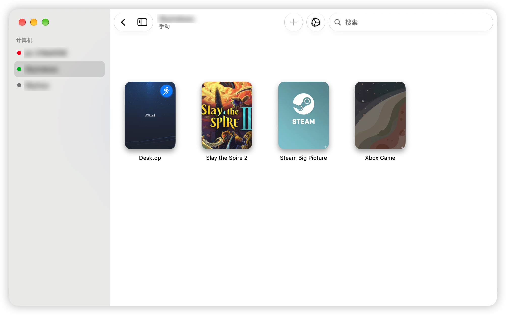
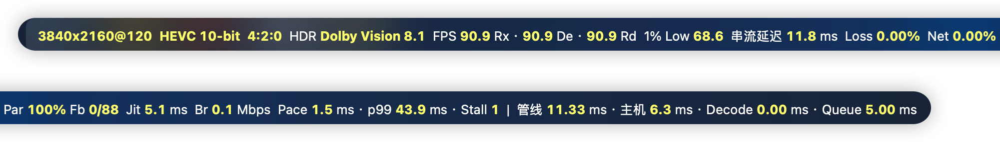
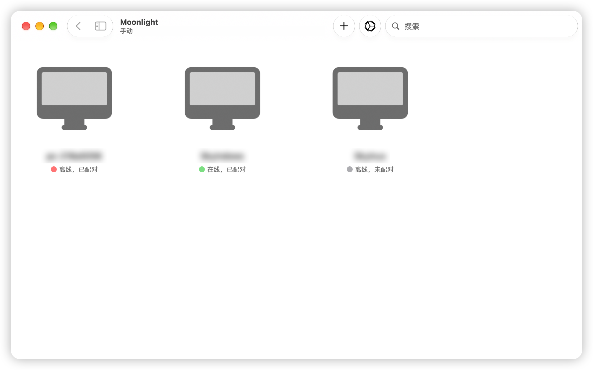
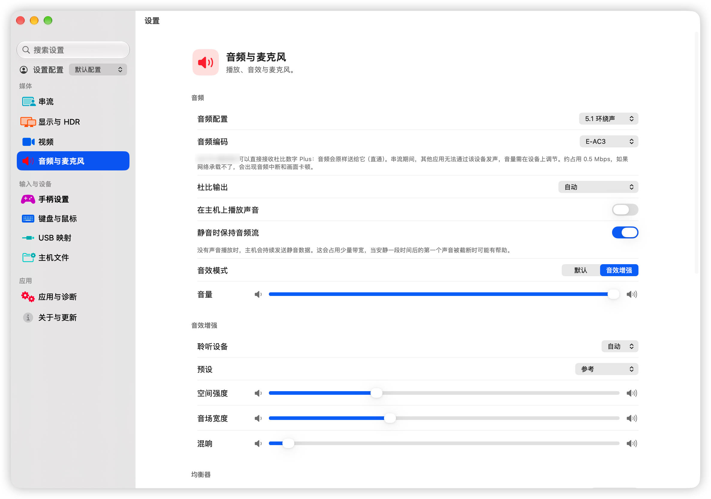
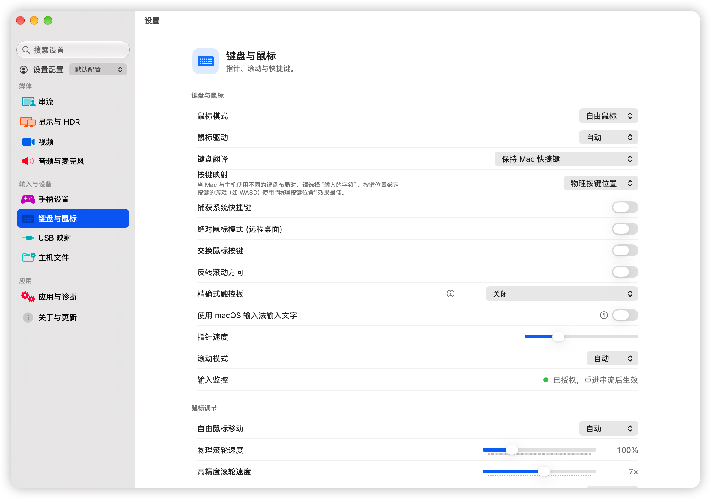
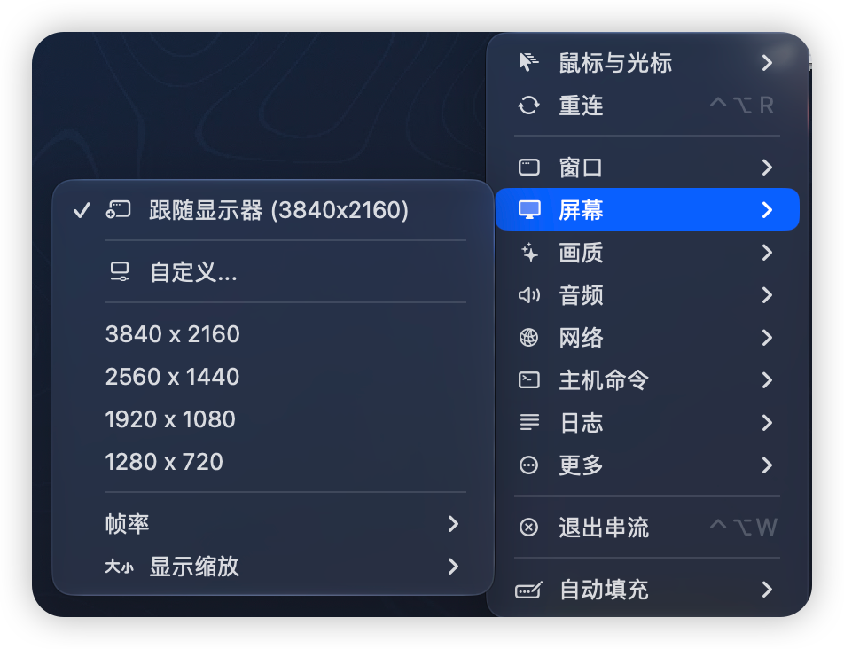

# Moonlight macOS Enhanced

<div align="center">

[](https://github.com/skyhua0224/moonlight-macos-enhanced/actions/workflows/build.yml) [](https://github.com/skyhua0224/moonlight-macos-enhanced/releases) [](https://github.com/skyhua0224/moonlight-macos-enhanced/releases) [](https://github.com/skyhua0224/moonlight-macos-enhanced/releases) [](LICENSE.txt)

**Moonlight macOS / Moonlight for macOS 原生增强版客户端**

`Moonlight macOS Enhanced` 是一个原生 macOS 串流客户端，用于连接 Sunshine、Foundation Sunshine 与兼容 GameStream 的主机。界面使用 AppKit / SwiftUI 构建，支持 Apple Silicon 与 Intel Mac，要求 macOS 12 或更高版本。

简体中文 | [English](README.en.md)

[下载](https://github.com/skyhua0224/moonlight-macos-enhanced/releases) · [更新说明](.github/release-notes/v1.3.9-rc.4.md) · [问题反馈](https://github.com/skyhua0224/moonlight-macos-enhanced/issues)



</div>

**目录**：[当前版本](#当前版本) · [快速开始](#快速开始) · [功能概览](#功能概览) · [截图](#截图) · [主机端兼容性](#主机端兼容性) · [安装](#安装) · [视频与 HDR](#视频与-hdr) · [音频](#音频) · [键盘、鼠标与触控板](#键盘鼠标与触控板) · [手柄](#手柄) · [控制中心](#串流中的控制中心) · [Foundation Sunshine 协作](#foundation-sunshine-协作) · [连接与诊断](#连接与诊断) · [更新](#更新) · [从源码构建](#从源码构建) · [问题反馈](#问题反馈)

## 当前版本

最新版本是 **1.3.9 RC4**（预发布），变更见 [1.3.9 RC4 更新说明](.github/release-notes/v1.3.9-rc.4.md)。1.3.9 是原生架构重建前最后一个版本。

- 从 [Releases](https://github.com/skyhua0224/moonlight-macos-enhanced/releases) 下载。安装包有 `universal`、`arm64`、`x86_64` 三种，不确定时选 `universal`。
- 已安装 1.3.9 的用户可以在 `设置 → 关于与更新` 检查更新。
- 首次打开被 macOS 拦截时，见下文“安装”一节。

1.3.9 相比 1.3.8 的主要变化：

- 设置界面重新设计，可以搜索具体选项，也可以用手柄操作整个应用。
- 音频新增无损 PCM、AC3、E-AC3 与杜比直通，串流中可切换输出设备；音效增强新增参数均衡器、耳机校正预设和耳机上的双耳环绕声。
- 输入新增精确式触控板、macOS 输入法输入文字和按字符的按键映射；DualSense 支持触控板、灯光、电量与触觉反馈。
- 视频新增独立的 10-bit SDR、动态 HDR 偏好，以及 Dolby Vision 与 HDR10+ 的协商和回退；没有 AV1 硬件解码的 Mac 可以用软件解码 AV1。
- 配合 Foundation Sunshine：显示器与虚拟显示器配置，串流中不重连调整码率、帧率和分辨率，自适应码率，主机显示缩放与主机命令。
- 新增应用内更新、性能报告导出和中英文日志查看器。

## 快速开始

1. 在要串流的电脑上安装并运行 [Foundation Sunshine](https://github.com/AlkaidLab/foundation-sunshine) 或 [Sunshine](https://github.com/LizardByte/Sunshine)。
2. 在 Mac 上安装本应用并打开。首次启动时允许“本地网络”权限，同一局域网内的主机会自动出现；也可以手动添加主机地址。
3. 点击主机开始配对：应用会显示一个 PIN，在主机的 Sunshine 网页界面中输入它。
4. 配对完成后选择一个应用开始串流。按 `Ctrl` + `Option` 释放鼠标；全屏时按 `Ctrl` + `Option` + `C` 打开控制中心。

## 功能概览

| 方面 | 内容 |
| --- | --- |
| 视频 | AV1（无硬件解码时用软件解码）/ HEVC / H.264，自定义分辨率与帧率，YUV 4:4:4，10-bit SDR；原生、Metal、兼容三种渲染器；VT 超分、MetalFX 与插帧 |
| HDR | HDR10（PQ / HLG）；Dolby Vision 8.1 / 8.4 与 HDR10+ 的协商和回退；主机中途开关 HDR 时画面随之切换 |
| 音频 | Opus 立体声、5.1、7.1、7.1.4；无损 PCM、AC3、E-AC3；杜比直通到 HDMI 设备；独立的输出设备；音效增强、参数均衡器与耳机校正预设、双耳环绕声；麦克风 |
| 键盘、鼠标、触控板 | 锁定鼠标与自由鼠标；CoreHID 高回报率鼠标；精确式触控板；macOS 输入法输入文字；按位置或按字符的按键映射；快捷键翻译；Windows 键位顺序；捕获系统快捷键；键入剪贴板文本 |
| 手柄 | 多手柄、震动、动作输入、手柄鼠标；DualSense 触控板、灯光、电量与触觉反馈；用手柄操作应用界面 |
| 串流控制 | 串流中的控制中心；不重连调整码率、帧率和分辨率；自适应码率；视频 FEC 偏好 |
| 主机协作 | 双向剪贴板、显示器与虚拟显示器配置、主机显示缩放、主机命令、休眠主机、USB 映射、主机文件 |
| 设置 | 设置搜索；配置方案：与默认配置对照、复制设置、预设、导入与导出 |
| 诊断与更新 | 性能浮窗、性能报告导出、中英文日志查看器、应用内更新 |

其中一部分需要 Foundation Sunshine，见下一节。

## 截图

串流中的性能浮窗：



| 主机列表 | 音频与麦克风设置 |
|:--------:|:----------------:|
|  |  |

| 键盘与鼠标设置 | 串流中的控制中心 |
|:--------------:|:----------------:|
|  |  |

截图中的主机名称和地址已做模糊处理。

## 主机端兼容性

| 主机软件 | 兼容性 | 备注 |
|----------|--------|------|
| [Foundation Sunshine](https://github.com/AlkaidLab/foundation-sunshine) | ⭐ 推荐 | 可使用本客户端的全部功能；具体能力取决于主机版本和配置 |
| [Sunshine (LizardByte)](https://github.com/LizardByte/Sunshine) | ✅ 支持 | 视频、Opus 音频、键鼠和手柄可用；下列增强功能不可用 |
| GeForce Experience | ⚠️ 基础支持 | 已停止维护，仅基础串流 |

以下功能需要 Foundation Sunshine，并且主机端启用了对应能力：

- 麦克风、7.1.4 声道、无损 PCM、AC3 与 E-AC3 音频
- 双向剪贴板、显示器与虚拟显示器（VDD）配置、主机显示缩放
- 串流中不重连调整码率、帧率和分辨率，自适应码率，视频 FEC 偏好
- DualSense 的触控板、灯光与触觉反馈，精确式触控板
- 主机命令、休眠主机、USB 映射、主机文件

## 安装

系统要求：macOS 12 或更高版本，Apple Silicon 或 Intel Mac；主机端运行 Sunshine 或 Foundation Sunshine。

从 [Releases](https://github.com/skyhua0224/moonlight-macos-enhanced/releases) 下载 `.dmg`，打开后把 `MoonlightEnhanced.app` 拖到“应用程序”。应用使用独立的名称和标识，可以与 Moonlight QT 版本同时安装。

> ⚠️ 此应用当前未做 Apple 公证。若 macOS 提示“MoonlightEnhanced.app 已损坏”或阻止打开，通常是 Gatekeeper 拦截未公证应用，并不代表文件损坏。
>
> 首次启动建议按这个顺序尝试：
> 1. 右键应用，选择“打开”
> 2. 前往 **系统设置 → 隐私与安全性**，选择“仍要打开”
> 3. 若仍被拦截，执行：
>    `xattr -dr com.apple.quarantine /Applications/MoonlightEnhanced.app`

## 视频与 HDR

### 渲染器

在 `设置 → 视频` 选择渲染器：

| 渲染器 | 适用场景 |
| --- | --- |
| 原生渲染器（默认） | VideoToolbox 解码后由系统直接呈现，延迟低，色彩与 HDR 由系统处理 |
| Metal 渲染器 | 需要手动调节 HDR 与色彩时使用：传输函数、元数据来源、显示器亮度参数、EDR 与色调映射策略，以及显示同步和帧队列等呈现时序 |
| 兼容渲染器 | 保留的旧链路，用于旧系统或排查问题 |

只适用于某个渲染器的设置项只在选中它时显示。画质增强可使用 `VT 低延迟超分`、`VT 高质量超分`、`MetalFX`、`基础缩放` 和 `VT 低延迟插帧`，不可用时自动回退。

### HDR 与色彩

- `10-bit SDR` 是独立选项，不需要开启 HDR；主机与解码器需支持对应的 10-bit 格式。
- `动态 HDR 偏好` 可选自动、Dolby Vision、HDR10+ 或仅 HDR10。性能浮窗会显示实际协商到的格式，以及回退时的原因。
- Dolby Vision 8.1 / 8.4 与 HDR10+ 提供能力探测、协商与安全回退，最终输出取决于系统、硬件和显示链路。macOS 的公共接口不能保证完整保留 HDR10+ 动态元数据，此时使用基础 HDR 输出。
- 开启 HDR 且未手动填写亮度参数时，客户端按当前屏幕自动上报亮度；主机在串流中开关 HDR，画面会随之切换。

## 音频

在 `设置 → 音频与麦克风` 选择声道布局和音频编码：

| 音频编码 | 说明 |
| --- | --- |
| Opus（默认） | 支持立体声、5.1、7.1 与 7.1.4，占用带宽最小，所有主机可用 |
| 无损 (PCM) | 不经压缩，最多 5.1 声道；占用带宽明显更高，建议在有线局域网使用 |
| AC3 / E-AC3 | 最多 5.1 声道；可直通给能接收杜比码流的 HDMI 功放或电视，也可在本机解码 |

- `杜比输出` 决定 AC3 / E-AC3 是直通给输出设备还是在本机解码。直通期间该设备由串流独占，音量在设备上调节；直通失败或更换设备时自动改为本机解码。
- 音频编码与声道布局冲突（例如 PCM 配 7.1）时，设置页会让你选择保留哪一个。主机不支持所选编码时回退到 Opus 并提示。
- `输出设备` 让串流声音从指定设备播放而不改变系统输出；杜比直通也送到这个设备。
- 输出设备是耳机或立体声音箱时可开启 `音效增强`：参数均衡器（12 段、24 段或自由频段，可拖动曲线调整）、`预设 EQ`（通用预设、6000 多款耳机的校正数据、自己保存的预设，可导入和导出）、`空间音频`（耳机上对 5.1 / 7.1 / 7.1.4 做双耳渲染）与音场调节。
- 主机没有送出 7.1.4 音频时，客户端会提示并改用 7.1 重新连接，之后这台主机直接使用 7.1；可在音频设置里重试 7.1.4。自动改用 7.1 需要 Foundation Sunshine 并开启 `静音时保持音频流`，否则只给出提示。
- `静音时保持音频流` 让主机在无声时继续发送静音，避免安静一段时间后第一声被截断。
- 串流中可在控制中心切换音频输出设备和调节音量。

## 键盘、鼠标与触控板

### 鼠标

- **自由鼠标**（默认）：适合远程桌面和多屏环境，指针可以移出串流窗口到其他显示器。
- **锁定鼠标**：适合游戏等需要持续相对移动的场景。
- 鼠标驱动默认为自动，按 `CoreHID → HID → MFI` 的顺序选择。`CoreHID` 提供高回报率的相对移动，可设置回报率上限。
- 支持本地光标、指针速度、左右键交换和反转滚动。滚轮按 `物理滚轮`、`改写 / 平滑滚轮`、`触控板` 三种来源分别设置。

### 触控板

`精确式触控板` 把 Mac 触控板上的手指触点直接交给 Windows，由 Windows 处理手势与滚动：

| 选项 | 行为 |
| --- | --- |
| 关闭 | 触控板作为鼠标使用 |
| 开启 – 屏蔽 macOS 触控板指针事件 | 指针完全由 Windows 控制。本机指针位置不再同步，全屏悬浮球和移到其他显示器会受影响 |
| 开启 – 同时使用 | 单指移动仍走 Mac 的指针路径，多指手势交给 Windows |

授予辅助功能权限后，串流期间会屏蔽 macOS 的系统手势（如调度中心），避免与 Windows 手势冲突。

### 键盘

- `按键映射` 默认按物理按键位置发送。使用 Dvorak、Colemak 等布局时可改为 `输入的字符`，按当前 Mac 布局实际输入的字符发送。
- `使用 macOS 输入法输入文字`：拼音等输入法在本机完成组字，确认后的文字发送到主机；普通按键和快捷键仍作为按键发送。
- 支持常用 Windows 快捷键翻译和自定义翻译规则；单独按 Command 可作为 Windows 键。

### 串流快捷键

以下快捷键可在 `设置 → 键盘与鼠标` 中调整：

| 快捷键 | 功能 | 说明 |
|--------|------|------|
| `Ctrl` + `Option` | 释放鼠标捕获 | 串流窗口中 |
| `Ctrl` + `Option` + `S` | 切换性能浮窗 | 串流窗口中 |
| `Ctrl` + `Option` + `M` | 切换鼠标模式 | 串流窗口中 |
| `Ctrl` + `Option` + `G` | 切换全屏悬浮球 | 全屏模式 |
| `Ctrl` + `Option` + `W` | 断开串流 | 串流窗口中 |
| `Ctrl` + `Shift` + `W` | 断开并退出应用 | 串流窗口中 |
| `Ctrl` + `Option` + `C` | 打开控制中心 | 仅全屏 / 无边框 |
| `Ctrl` + `Option` + `Command` + `B` | 无边框 / 窗口切换 | 高级排障快捷键 |

标准 macOS 快捷键（如 `⌘W`、`⌃⌘F`）不在此表内。

## 手柄

- 支持多手柄、震动、Guide 模拟、按键交换、摇杆死区和手柄模拟鼠标。
- `主机控制器类型` 可选自动、Xbox 360、DualShock 4 或 DualSense，启动和恢复串流时告知主机。
- 可以用手柄操作应用本身：浏览应用列表和设置、打开菜单、调整滑块与选择器、用屏幕键盘输入，串流中打开控制中心。
- `手柄快捷键` 可为按键组合和触控板手势指定动作。

### DualSense / DS5

DS5 可通过蓝牙或 USB 连接 Mac。除普通手柄输入外，以下能力需要主机提供 PlayStation 虚拟控制器及对应反馈：

| 能力 | 使用方式 |
| --- | --- |
| 震动与触觉反馈 | 接收主机反馈，按设备能力使用原生触觉或震动回退；效果取决于主机、系统和连接方式 |
| 灯光与电量 | 同步主机灯光反馈并向主机报告电量 |
| 动作输入 | 陀螺仪和加速度传感器，可在设置中调整动作传感器模式 |
| 主机触控板 | 把触控位置和按压发送给远端虚拟控制器，供游戏使用 |
| Mac 风格触控板 | 单指移动指针、轻点点击、双指滚动和双指轻点右键；滚动跟随 macOS 自然滚动偏好 |
| 精确式触控板 | 把触点交给 Windows 作为触控板使用；DualSense 触控板最多识别两指 |

在 `设置 → 手柄设置` 选择 `DualSense 触控板模式`。开启 `长按 Options 切换触控板模式` 后，串流中长按 **Options 键约 2 秒**即可切换；按键、摇杆和扳机始终作为手柄输入。

## 串流中的控制中心

全屏或无边框时按 `Ctrl` + `Option` + `C`，或通过全屏悬浮球、手柄打开控制中心。菜单按用途分组：

- **屏幕**：分辨率、帧率和主机显示缩放。配合 Foundation Sunshine 时分辨率与帧率直接生效，否则通过重新连接应用。客户端不会在开始串流时改动主机的缩放，只有在这里手动调整才会改变。
- **画质与网络**：码率等串流参数。
- **音频**：切换输出设备、调节音量。
- **主机命令**：运行主机为当前应用配置的命令。
- **鼠标与光标、窗口、日志**：切换鼠标模式和窗口方式，打开日志查看器。
- **重连**与**退出串流**。

`设置 → 串流` 另有 `自适应码率`（默认关闭）：开启后在串流前探测带宽，并在串流中由主机根据丢包和延迟调整码率。`视频 FEC` 可保持主机默认、自动或指定比例。

## Foundation Sunshine 协作

- **剪贴板**：在 `设置 → 串流 → 剪贴板` 开启，并在主机端启用剪贴板。支持文本与单张 PNG 图片的双向复制粘贴，由当前前台的串流窗口接管。它不是文件传输。
- **显示器与虚拟显示器**：`设置 → 显示与 HDR` 提供目标显示器、虚拟显示器（VDD）、屏幕模式和显示参数，可按应用保存，连接或重连时交给主机应用。VDD 需要主机驱动已启用。
- **主机操作**：正在运行的应用的右键菜单可运行主机命令，主机的右键菜单提供“休眠主机”。
- **USB 映射**（实验性）：`设置 → USB 映射` 把所选本机 USB 设备转发给主机，串流停止时释放。
- **主机文件**（实验性）：`设置 → 主机文件` 浏览主机共享的目录，只读。Finder 挂载需要支持相应 App Group 的签名版本。

USB 映射和主机文件的页面会显示主机能力及不可用原因。

## 连接与诊断

- 每台主机可单独设置连接方式，支持自定义端口、IPv6 和域名；首选地址不可用时继续尝试其他已知地址。
- 性能浮窗显示帧率、码率、延迟、网络丢帧、FEC 结果和协商到的 HDR 格式。
- `设置 → 应用与诊断` 可查看并导出性能报告：接收、解码、呈现帧率，1% low，网络与呈现抖动，丢帧和音频欠载。
- 日志查看器提供浓缩与原始两种视图，支持中英文、筛选和搜索，也可以在串流窗口内打开。
- 提供连接警告、自动重连、超时恢复和 AWDL 稳定性辅助。

## 更新

`设置 → 关于与更新` 显示当前版本并可检查更新，应用菜单中也有“检查更新”。更新优先从 GitHub 下载，失败时尝试同版本的 CNB 镜像，更新包签名由 Sparkle 验证。也可以随时从 [Releases](https://github.com/skyhua0224/moonlight-macos-enhanced/releases) 手动下载安装。

## 从源码构建

```bash
git clone --recursive https://github.com/skyhua0224/moonlight-macos-enhanced.git
cd moonlight-macos-enhanced

curl -L -o xcframeworks.zip "https://github.com/coofdy/moonlight-mobile-deps/releases/download/latest/moonlight-apple-xcframeworks.zip"
unzip -o xcframeworks.zip -d xcframeworks/

# AV1 软件解码用的 dav1d（需要 meson、ninja、nasm）
brew install meson ninja nasm
scripts/build_dav1d.sh
```

然后：
1. 用 Xcode 打开 `Moonlight.xcodeproj`
2. 在 **Signing & Capabilities** 中改成你自己的 Team
3. 按需修改 Bundle Identifier
4. 选择 **Moonlight for macOS** scheme 后运行

## 问题反馈

提交 Bug 时请包含：
- macOS 版本、机型与芯片类型
- 主机端软件及版本
- 复现步骤
- `设置 → 应用与诊断` 导出的调试日志，必要时附截图

输入类问题请另外说明：
- 使用的是 **自由鼠标** 还是 **锁定鼠标**，鼠标驱动是 **自动 / CoreHID / HID / MFI** 中的哪一个
- 是否开启了精确式触控板，以及所选的方式
- 是否使用了 Mos、BetterMouse、SteerMouse 等第三方鼠标工具
- 手柄型号与连接方式（蓝牙或 USB）

## 贡献

欢迎提交 Issue 和 PR。建议：
- 保持中英文用户文案同步
- 提交前至少验证核心串流与输入路径
- PR 描述写用户可感知的变化，而不是只贴 commit 标题

## 联系方式

- 📧 Email: [dev@sky-hua.xyz](mailto:dev@sky-hua.xyz)
- 💬 Telegram: [@skyhua](https://t.me/skyhua)
- 🐧 QQ: 2110591491
- 🔗 GitHub Issues: [提交 Issue](https://github.com/skyhua0224/moonlight-macos-enhanced/issues)

## 致谢

完整致谢、上游来源与生态参考请见 [ACKNOWLEDGEMENTS.md](ACKNOWLEDGEMENTS.md)。

- 直接代码基础：`moonlight-macos`、`moonlight-ios`、`moonlight-common-c`
- 功能与行为参考：`moonlight-qt`、`qiin2333/moonlight-qt`
- 主机端生态参考：`Sunshine`、`foundation-sunshine`
- 输入与滚轮体验参考：`Mos`、`Mouser`

## 许可证

本项目采用 [GPLv3 许可证](LICENSE.txt)。
