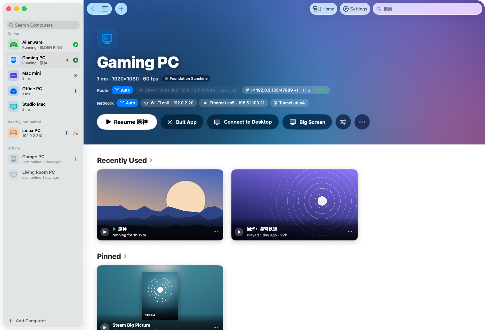
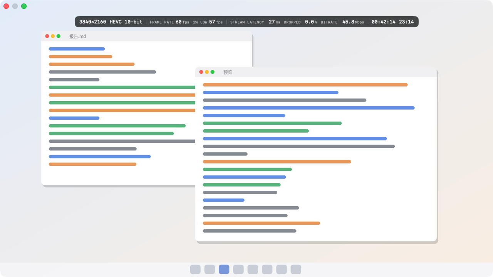
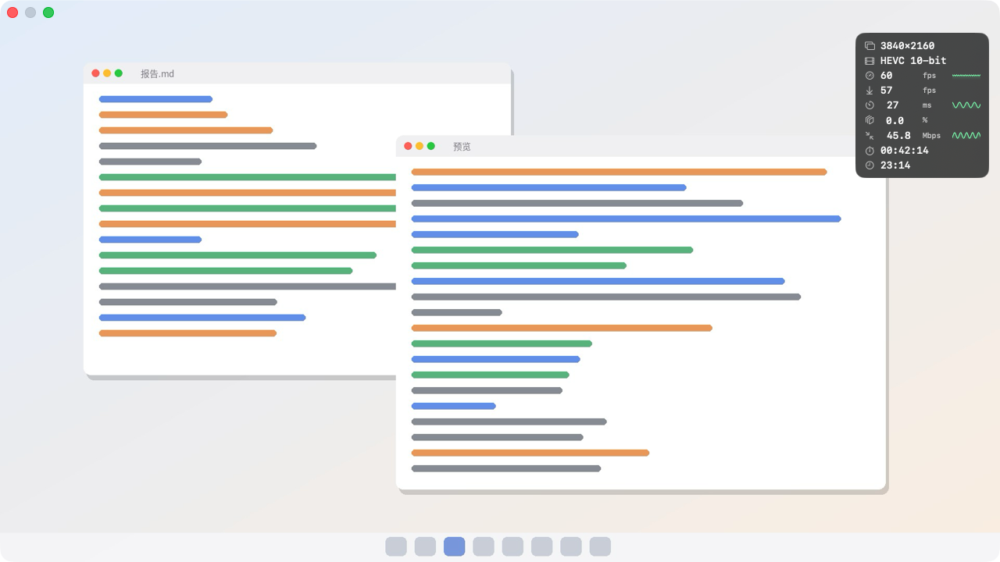
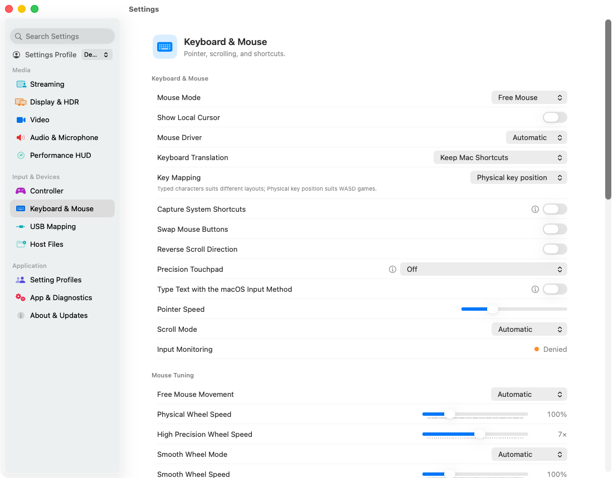

# Screenshots

[← Back to README](README.en.md)

<picture>
  <source media="(prefers-color-scheme: dark)" srcset="readme-assets/images/en/home-dark.png">
  
</picture>

## Performance HUD

Compact, corner and chart styles.

<table>
<tr>
<td width="50%" valign="top">

<picture>
  <source media="(prefers-color-scheme: dark)" srcset="readme-assets/images/en/hud-textBar-dark.png">
  
</picture>

<b>Compact</b>

</td>
<td width="50%" valign="top">

<picture>
  <source media="(prefers-color-scheme: dark)" srcset="readme-assets/images/en/hud-cornerList-dark.png">
  
</picture>

<b>Corner</b>

</td>
</tr>
<tr>
<td width="50%" valign="top">

<picture>
  <source media="(prefers-color-scheme: dark)" srcset="readme-assets/images/en/hud-chartHUD-dark.png">
  
</picture>

<b>Chart</b>

</td>
<td width="50%" valign="top">

<picture>
  <source media="(prefers-color-scheme: dark)" srcset="readme-assets/images/en/settings-overlay-dark.png">
  
</picture>

<b>HUD settings</b>

</td>
</tr>
</table>

## Settings

Searchable down to individual options, with full controller support.

<table>
<tr>
<td width="50%" valign="top">

<picture>
  <source media="(prefers-color-scheme: dark)" srcset="readme-assets/images/en/settings-video-dark.png">
  
</picture>

<b>Video & HDR</b>

</td>
<td width="50%" valign="top">

<picture>
  <source media="(prefers-color-scheme: dark)" srcset="readme-assets/images/en/settings-audio-dark.png">
  
</picture>

<b>Audio & Microphone</b>

</td>
</tr>
<tr>
<td width="50%" valign="top">

<picture>
  <source media="(prefers-color-scheme: dark)" srcset="readme-assets/images/en/settings-keyboard-mouse-dark.png">
  
</picture>

<b>Keyboard & Mouse</b>

</td>
<td width="50%" valign="top">

<picture>
  <source media="(prefers-color-scheme: dark)" srcset="readme-assets/images/en/settings-controller-dark.png">
  
</picture>

<b>Controller</b>

</td>
</tr>
<tr>
<td width="50%" valign="top">

<picture>
  <source media="(prefers-color-scheme: dark)" srcset="readme-assets/images/en/settings-profiles-dark.png">
  
</picture>

<b>Setting Profiles</b>

</td>
<td></td>
</tr>
</table>

Computer names, addresses, and artwork in the screenshots are examples.
