# Screenshots

[← Back to README](README.en.md)

<picture>
  <source media="(prefers-color-scheme: dark)" srcset="readme-assets/images/en/home-dark.png">
  
</picture>

## Home

Large-image and card views, an optional compact mode, portrait and landscape posters.

<table>
<tr>
<td width="50%" valign="top">

<picture>
  <source media="(prefers-color-scheme: dark)" srcset="readme-assets/images/en/home-dark.png">
  
</picture>

<b>Large-image view</b>

</td>
<td width="50%" valign="top">

<picture>
  <source media="(prefers-color-scheme: dark)" srcset="readme-assets/images/en/home-portrait-dark.png">
  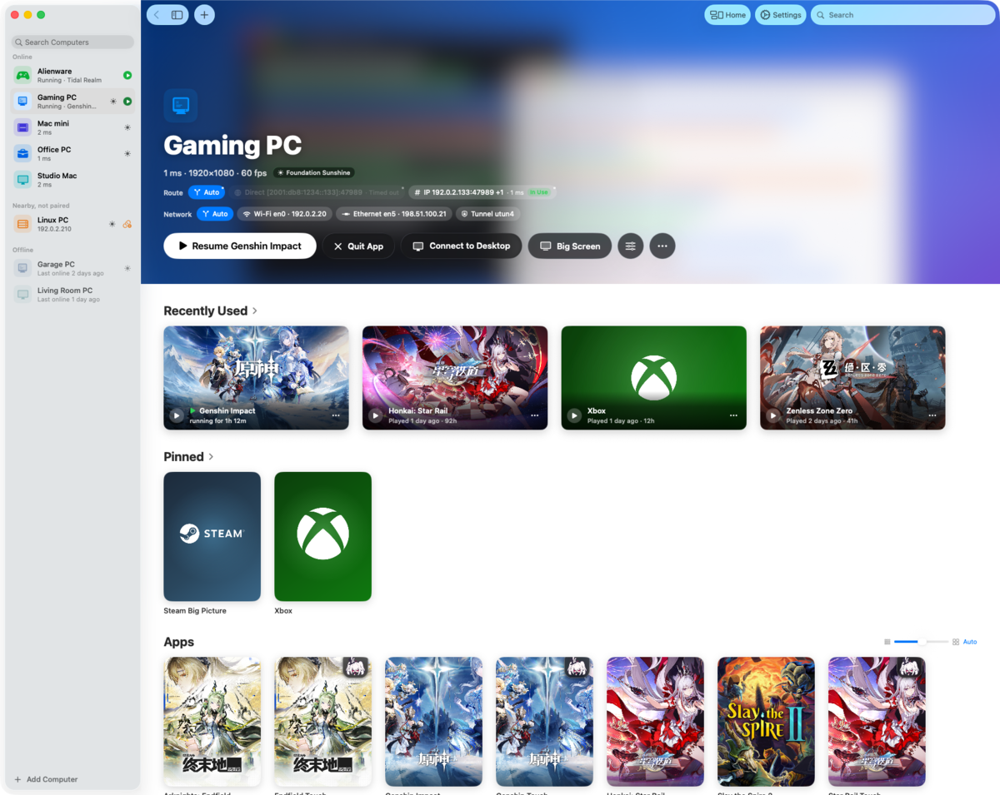
</picture>

<b>Large-image view · portrait posters</b>

</td>
</tr>
<tr>
<td width="50%" valign="top">

<picture>
  <source media="(prefers-color-scheme: dark)" srcset="readme-assets/images/en/home-card-dark.png">
  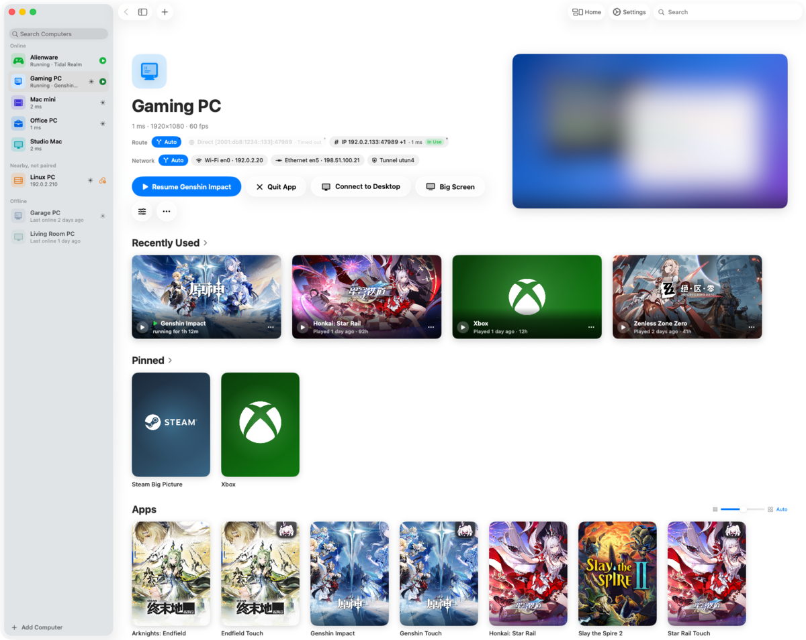
</picture>

<b>Card view · portrait posters</b>

</td>
<td width="50%" valign="top">

<picture>
  <source media="(prefers-color-scheme: dark)" srcset="readme-assets/images/en/home-simple-dark.png">
  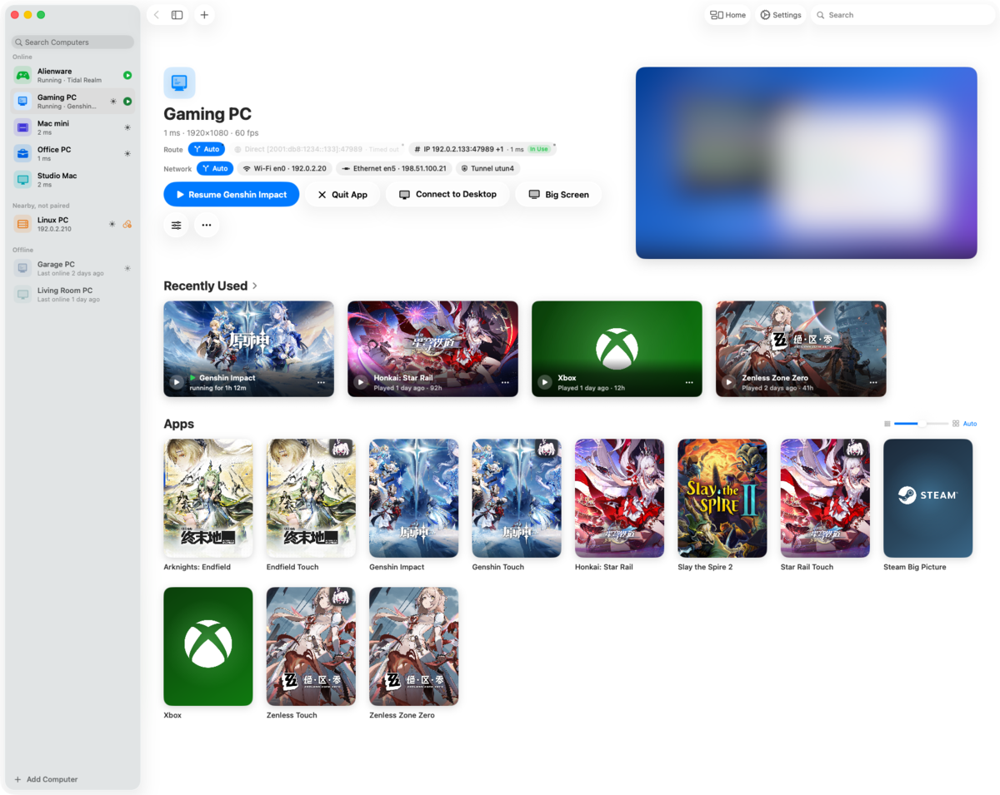
</picture>

<b>Compact mode</b>

</td>
</tr>
</table>

## Search

Settings can be searched by keyword.

<picture>
  <source media="(prefers-color-scheme: dark)" srcset="readme-assets/images/en/search-dark.png">
  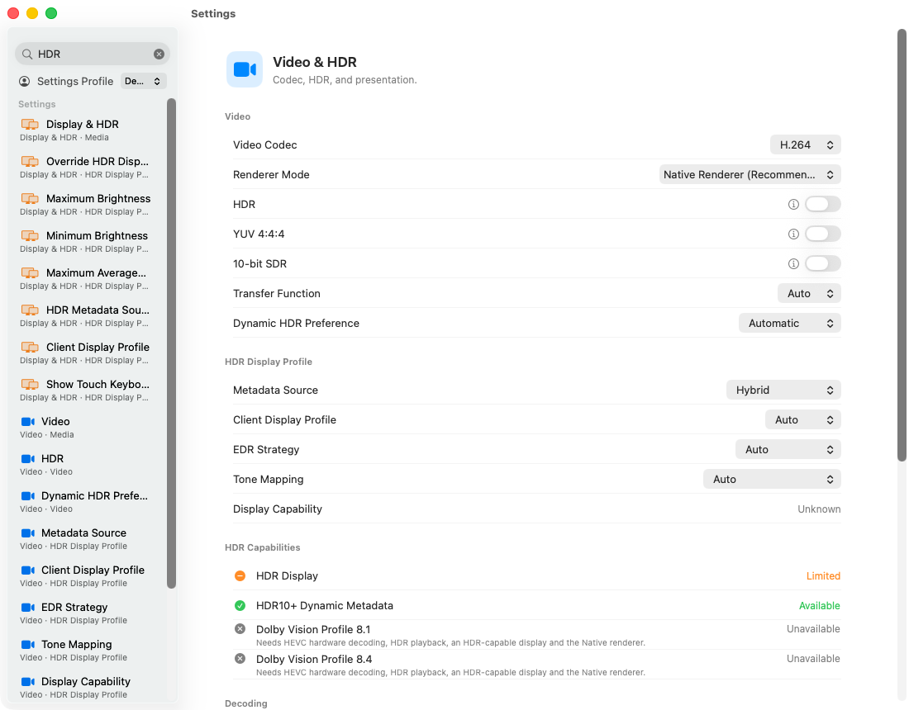
</picture>

## Control Center

The in-stream control center.

<table>
<tr>
<td width="50%" valign="top">

<picture>
  <source media="(prefers-color-scheme: dark)" srcset="readme-assets/images/en/cc-top-dark.png">
  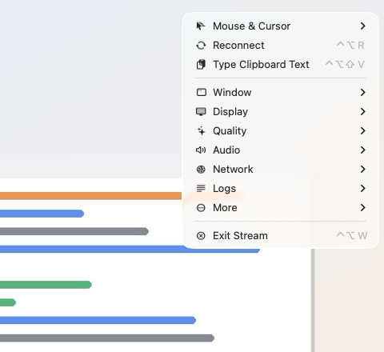
</picture>

<b>In-stream control center</b>

</td>
<td width="50%" valign="top">

<picture>
  <source media="(prefers-color-scheme: dark)" srcset="readme-assets/images/en/cc-window-dark.png">
  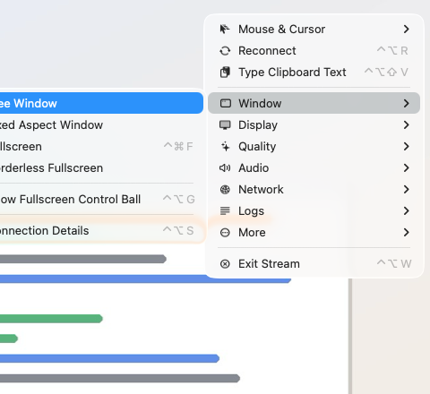
</picture>

<b>Window</b>

</td>
</tr>
<tr>
<td width="50%" valign="top">

<picture>
  <source media="(prefers-color-scheme: dark)" srcset="readme-assets/images/en/control-center-dark.png">
  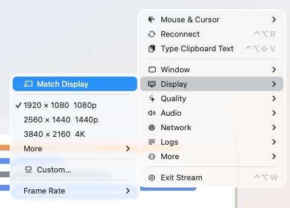
</picture>

<b>Display</b>

</td>
<td width="50%" valign="top">

<picture>
  <source media="(prefers-color-scheme: dark)" srcset="readme-assets/images/en/cc-quality-dark.png">
  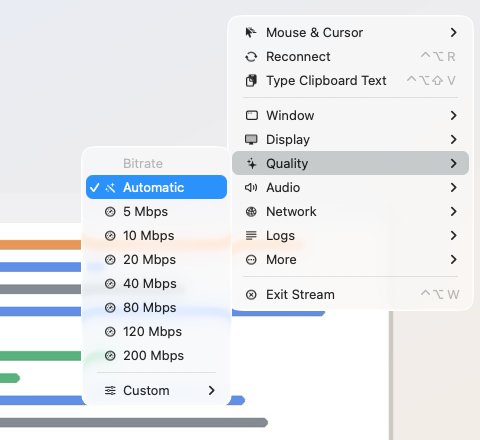
</picture>

<b>Quality</b>

</td>
</tr>
<tr>
<td width="50%" valign="top">

<picture>
  <source media="(prefers-color-scheme: dark)" srcset="readme-assets/images/en/cc-audio-dark.png">
  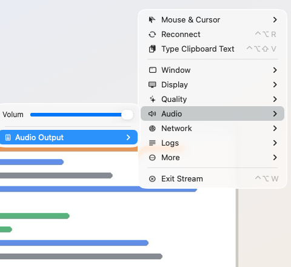
</picture>

<b>Audio</b>

</td>
<td width="50%" valign="top">

<picture>
  <source media="(prefers-color-scheme: dark)" srcset="readme-assets/images/en/cc-network-dark.png">
  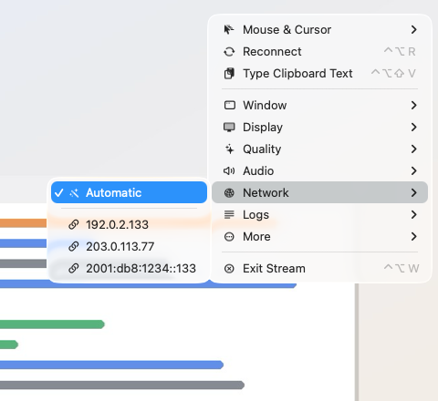
</picture>

<b>Network</b>

</td>
</tr>
</table>

## Performance HUD

Compact, corner and chart styles.

<table>
<tr>
<td width="50%" valign="top">

<picture>
  <source media="(prefers-color-scheme: dark)" srcset="readme-assets/images/en/hud-textBar-dark.png">
  
</picture>

<b>Compact</b>

</td>
<td width="50%" valign="top">

<picture>
  <source media="(prefers-color-scheme: dark)" srcset="readme-assets/images/en/hud-cornerList-dark.png">
  
</picture>

<b>Corner</b>

</td>
</tr>
<tr>
<td width="50%" valign="top">

<picture>
  <source media="(prefers-color-scheme: dark)" srcset="readme-assets/images/en/hud-chartHUD-dark.png">
  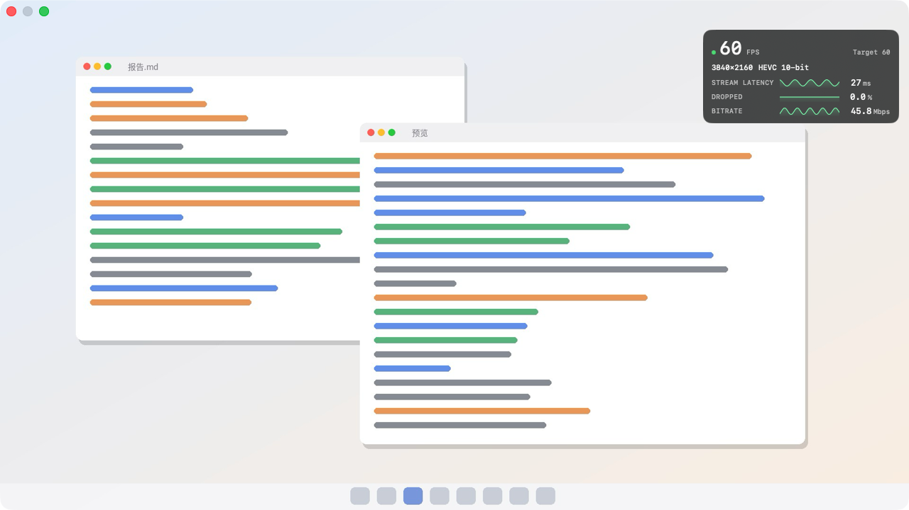
</picture>

<b>Chart</b>

</td>
<td width="50%" valign="top">

<picture>
  <source media="(prefers-color-scheme: dark)" srcset="readme-assets/images/en/settings-overlay-dark.png">
  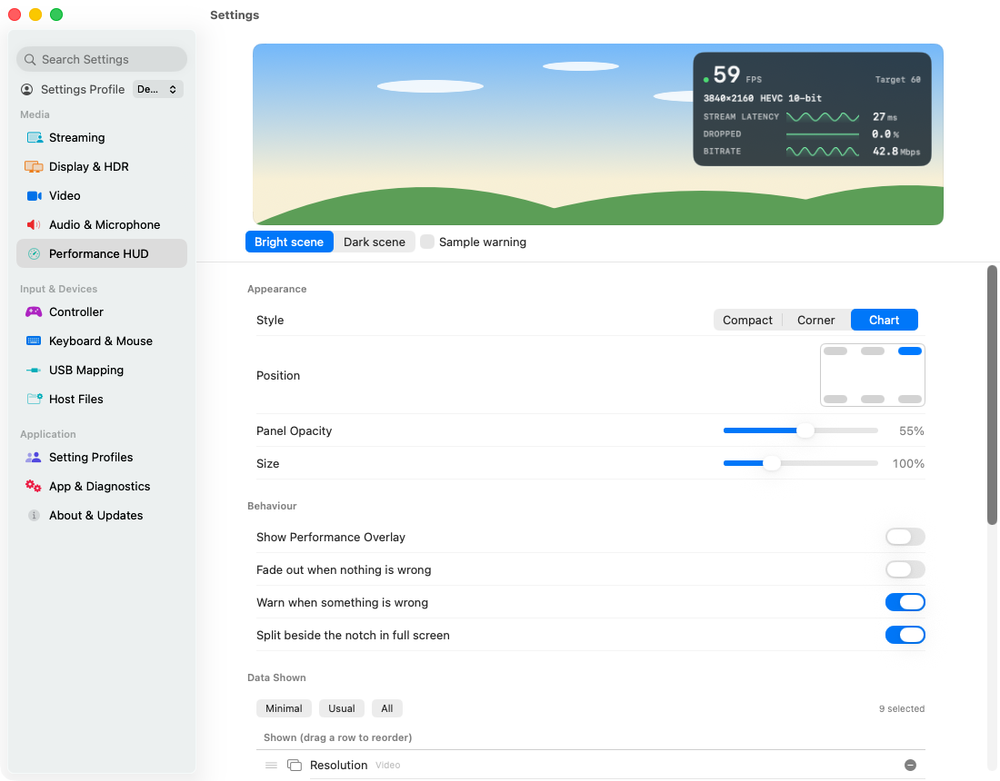
</picture>

<b>Performance HUD settings</b>

</td>
</tr>
</table>

## Settings

Every option is searchable; controller navigation is supported.

<table>
<tr>
<td width="50%" valign="top">

<picture>
  <source media="(prefers-color-scheme: dark)" srcset="readme-assets/images/en/settings-video-dark.png">
  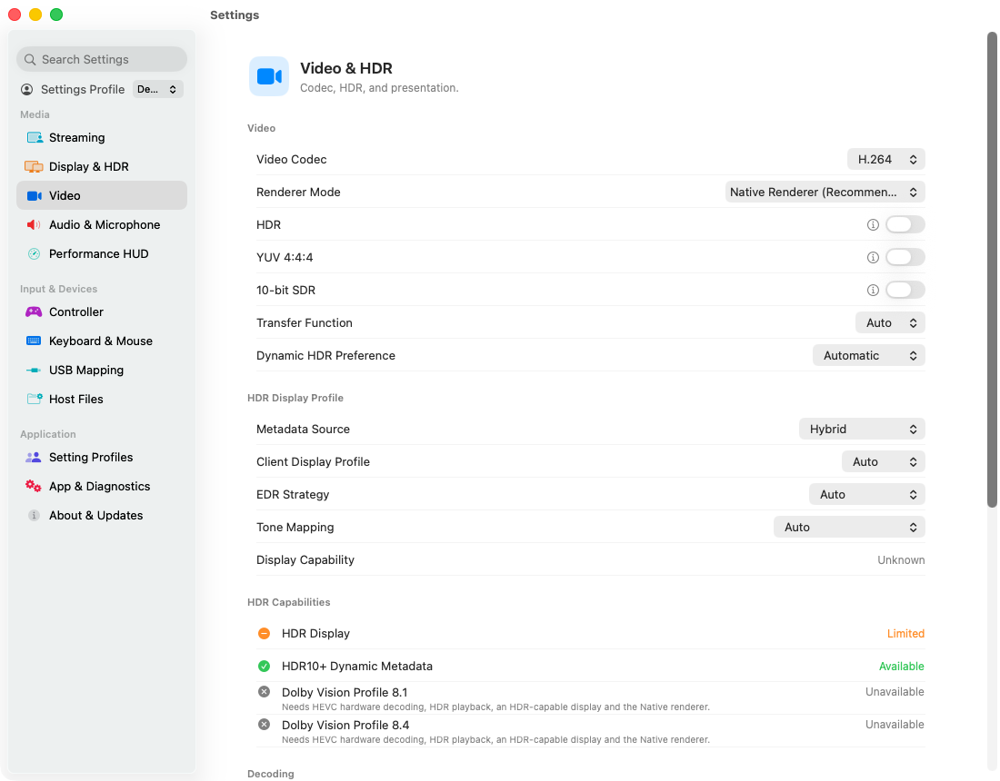
</picture>

<b>Video and HDR</b>

</td>
<td width="50%" valign="top">

<picture>
  <source media="(prefers-color-scheme: dark)" srcset="readme-assets/images/en/settings-audio-dark.png">
  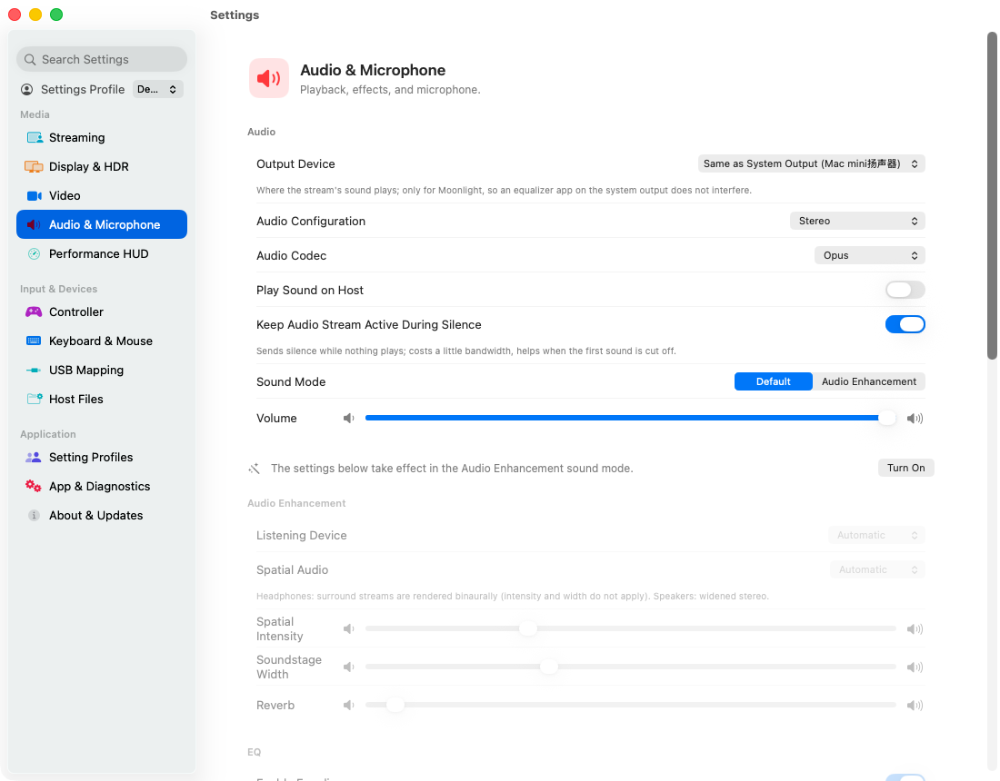
</picture>

<b>Audio and microphone</b>

</td>
</tr>
<tr>
<td width="50%" valign="top">

<picture>
  <source media="(prefers-color-scheme: dark)" srcset="readme-assets/images/en/settings-keyboard-mouse-dark.png">
  
</picture>

<b>Keyboard and mouse</b>

</td>
<td width="50%" valign="top">

<picture>
  <source media="(prefers-color-scheme: dark)" srcset="readme-assets/images/en/settings-controller-dark.png">
  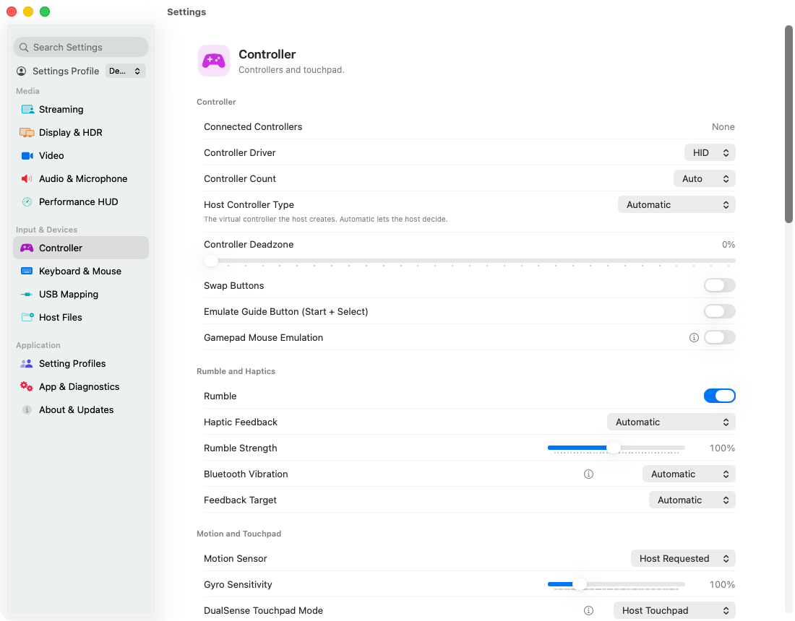
</picture>

<b>Controllers</b>

</td>
</tr>
<tr>
<td width="50%" valign="top">

<picture>
  <source media="(prefers-color-scheme: dark)" srcset="readme-assets/images/en/settings-profiles-dark.png">
  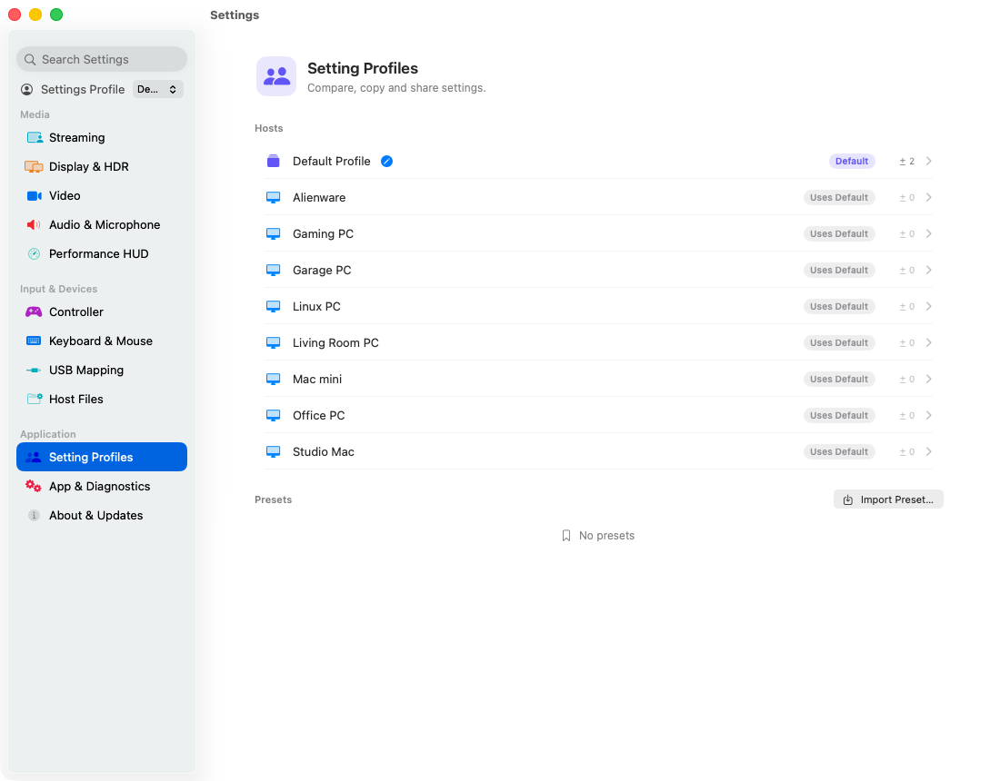
</picture>

<b>Profiles</b>

</td>
<td width="50%" valign="top">

<picture>
  <source media="(prefers-color-scheme: dark)" srcset="readme-assets/images/en/settings-more-dark.png">
  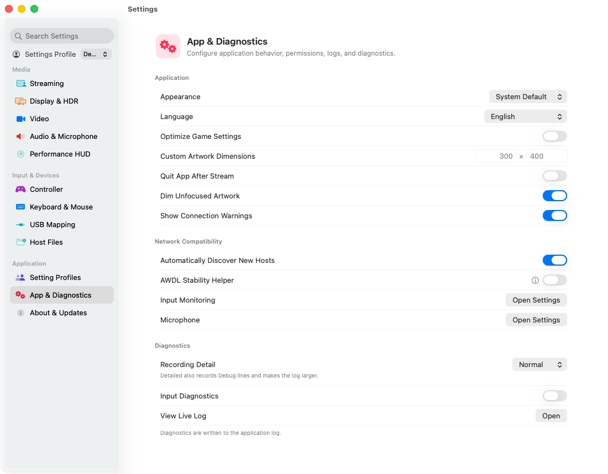
</picture>

<b>More settings</b>

</td>
</tr>
</table>

Computer names and addresses in the screenshots are examples. Game artwork belongs to its owners.
