# 截图

[← 返回 README](README.md)

<picture>
  <source media="(prefers-color-scheme: dark)" srcset="readme-assets/images/home-dark.png">
  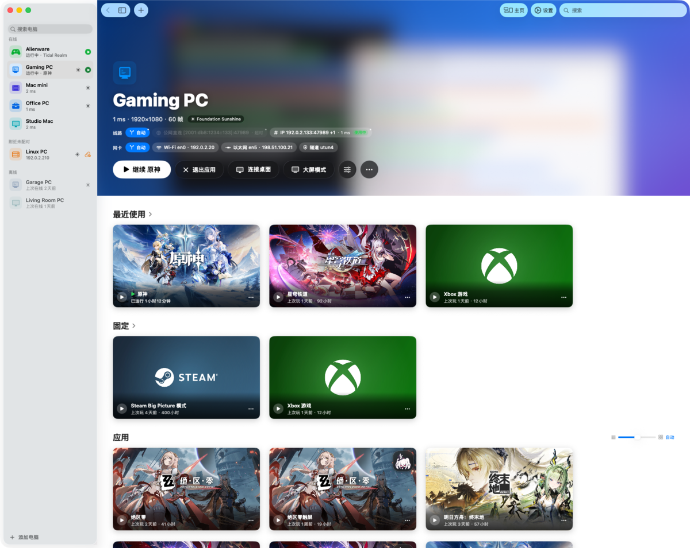
</picture>

## 主页

提供大图和卡片两种视图，可切换简约模式，支持竖版和横版海报。

<table>
<tr>
<td width="50%" valign="top">

<picture>
  <source media="(prefers-color-scheme: dark)" srcset="readme-assets/images/home-dark.png">
  
</picture>

<b>大图视图</b>

</td>
<td width="50%" valign="top">

<picture>
  <source media="(prefers-color-scheme: dark)" srcset="readme-assets/images/home-portrait-dark.png">
  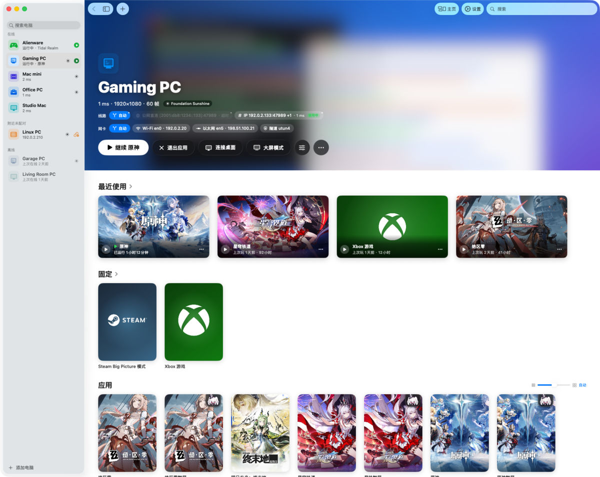
</picture>

<b>大图视图 · 竖版海报</b>

</td>
</tr>
<tr>
<td width="50%" valign="top">

<picture>
  <source media="(prefers-color-scheme: dark)" srcset="readme-assets/images/home-card-dark.png">
  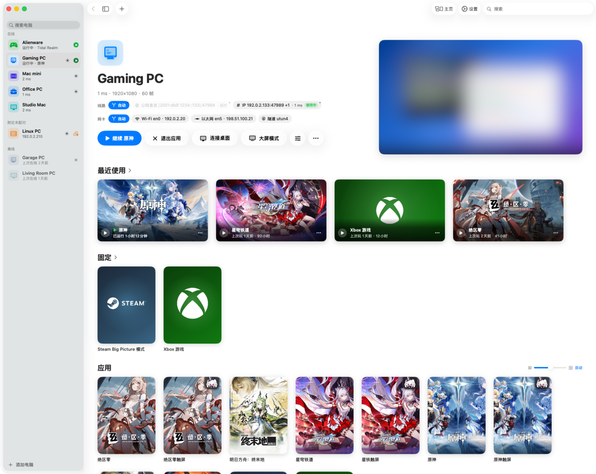
</picture>

<b>卡片视图 · 竖版海报</b>

</td>
<td width="50%" valign="top">

<picture>
  <source media="(prefers-color-scheme: dark)" srcset="readme-assets/images/home-simple-dark.png">
  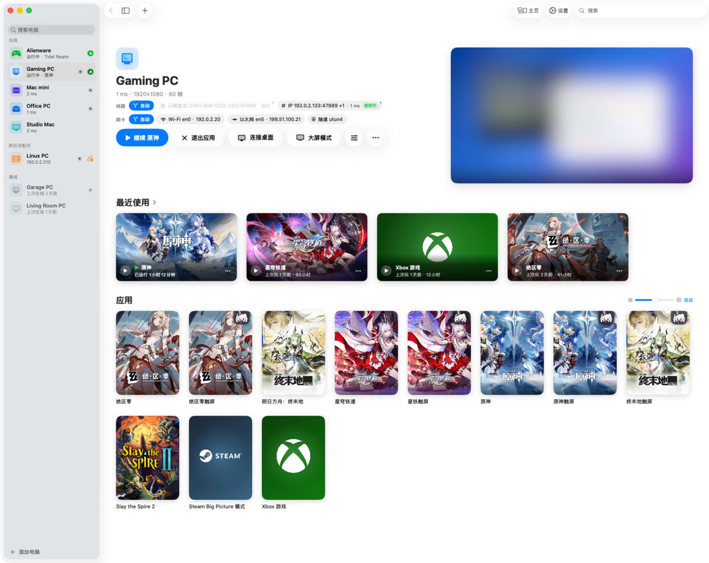
</picture>

<b>简约模式</b>

</td>
</tr>
</table>

## 搜索

设置可按关键词搜索到具体选项。

<picture>
  <source media="(prefers-color-scheme: dark)" srcset="readme-assets/images/search-dark.png">
  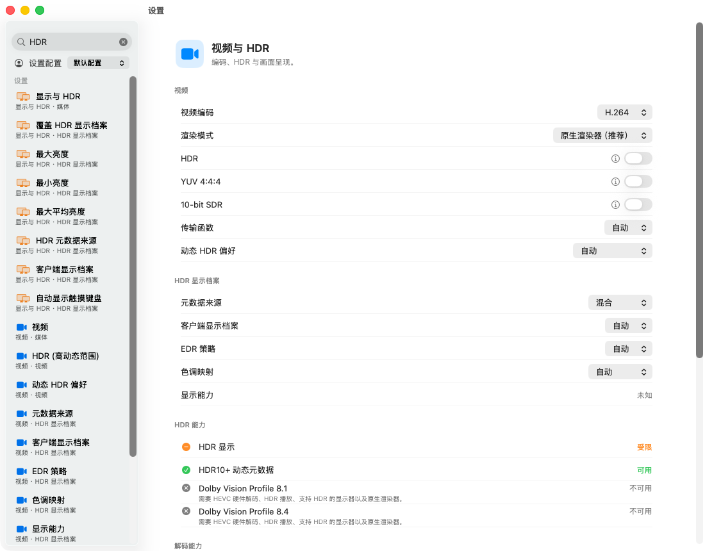
</picture>

## 控制中心

串流中的控制中心。

<table>
<tr>
<td width="50%" valign="top">

<picture>
  <source media="(prefers-color-scheme: dark)" srcset="readme-assets/images/cc-top-dark.png">
  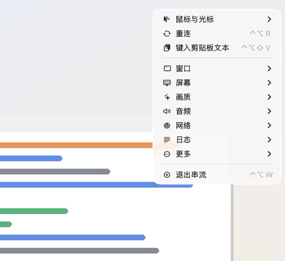
</picture>

<b>串流中的控制中心</b>

</td>
<td width="50%" valign="top">

<picture>
  <source media="(prefers-color-scheme: dark)" srcset="readme-assets/images/cc-window-dark.png">
  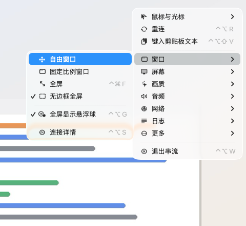
</picture>

<b>窗口</b>

</td>
</tr>
<tr>
<td width="50%" valign="top">

<picture>
  <source media="(prefers-color-scheme: dark)" srcset="readme-assets/images/control-center-dark.png">
  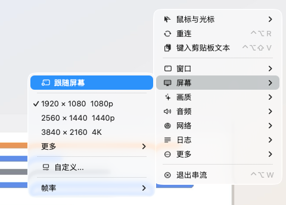
</picture>

<b>屏幕</b>

</td>
<td width="50%" valign="top">

<picture>
  <source media="(prefers-color-scheme: dark)" srcset="readme-assets/images/cc-quality-dark.png">
  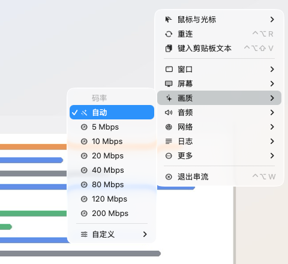
</picture>

<b>画质</b>

</td>
</tr>
<tr>
<td width="50%" valign="top">

<picture>
  <source media="(prefers-color-scheme: dark)" srcset="readme-assets/images/cc-audio-dark.png">
  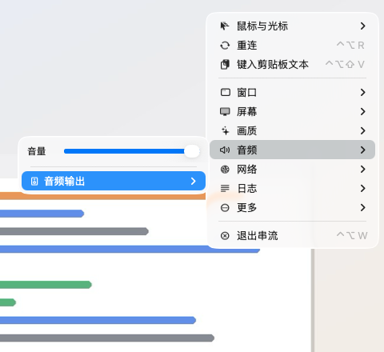
</picture>

<b>音频</b>

</td>
<td width="50%" valign="top">

<picture>
  <source media="(prefers-color-scheme: dark)" srcset="readme-assets/images/cc-network-dark.png">
  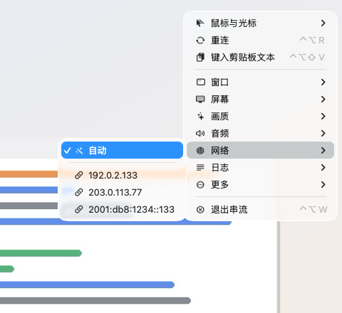
</picture>

<b>网络</b>

</td>
</tr>
</table>

## 性能浮窗

提供紧凑、角落、曲线三种样式。

<table>
<tr>
<td width="50%" valign="top">

<picture>
  <source media="(prefers-color-scheme: dark)" srcset="readme-assets/images/hud-textBar-dark.png">
  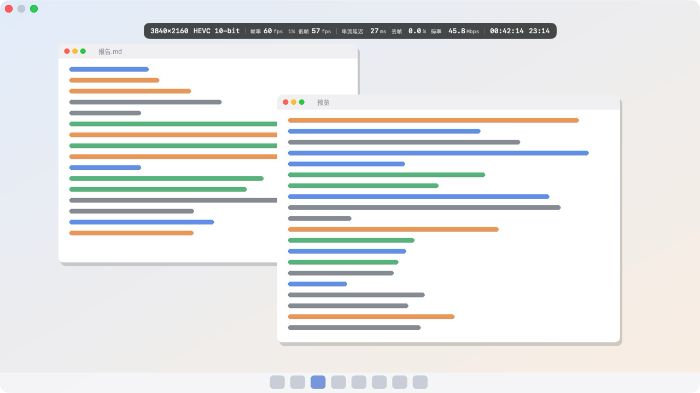
</picture>

<b>紧凑</b>

</td>
<td width="50%" valign="top">

<picture>
  <source media="(prefers-color-scheme: dark)" srcset="readme-assets/images/hud-cornerList-dark.png">
  
</picture>

<b>角落</b>

</td>
</tr>
<tr>
<td width="50%" valign="top">

<picture>
  <source media="(prefers-color-scheme: dark)" srcset="readme-assets/images/hud-chartHUD-dark.png">
  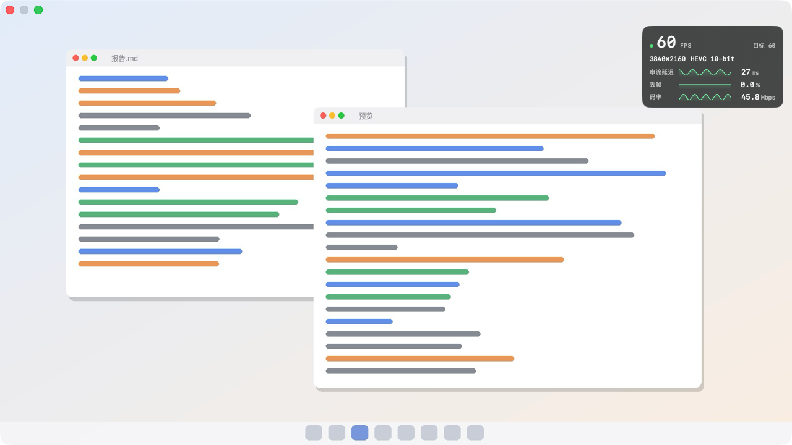
</picture>

<b>曲线</b>

</td>
<td width="50%" valign="top">

<picture>
  <source media="(prefers-color-scheme: dark)" srcset="readme-assets/images/settings-overlay-dark.png">
  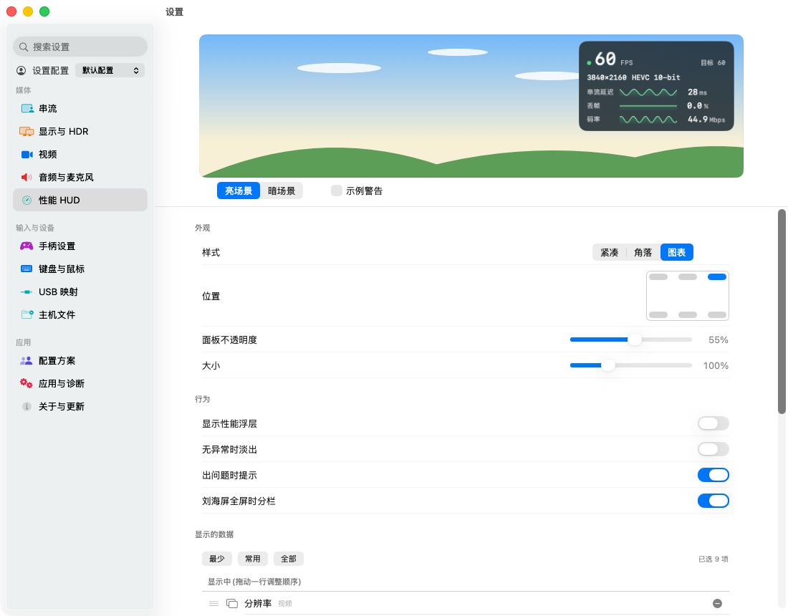
</picture>

<b>性能浮窗设置</b>

</td>
</tr>
</table>

## 设置

可搜索到具体选项，支持手柄操作。

<table>
<tr>
<td width="50%" valign="top">

<picture>
  <source media="(prefers-color-scheme: dark)" srcset="readme-assets/images/settings-video-dark.png">
  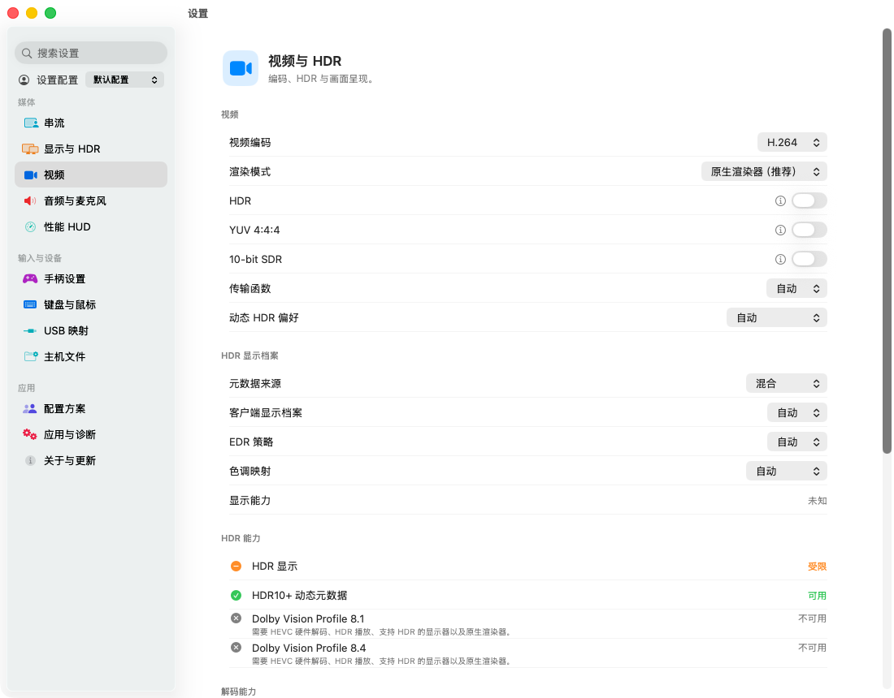
</picture>

<b>视频与 HDR</b>

</td>
<td width="50%" valign="top">

<picture>
  <source media="(prefers-color-scheme: dark)" srcset="readme-assets/images/settings-audio-dark.png">
  
</picture>

<b>音频与麦克风</b>

</td>
</tr>
<tr>
<td width="50%" valign="top">

<picture>
  <source media="(prefers-color-scheme: dark)" srcset="readme-assets/images/settings-keyboard-mouse-dark.png">
  
</picture>

<b>键盘与鼠标</b>

</td>
<td width="50%" valign="top">

<picture>
  <source media="(prefers-color-scheme: dark)" srcset="readme-assets/images/settings-controller-dark.png">
  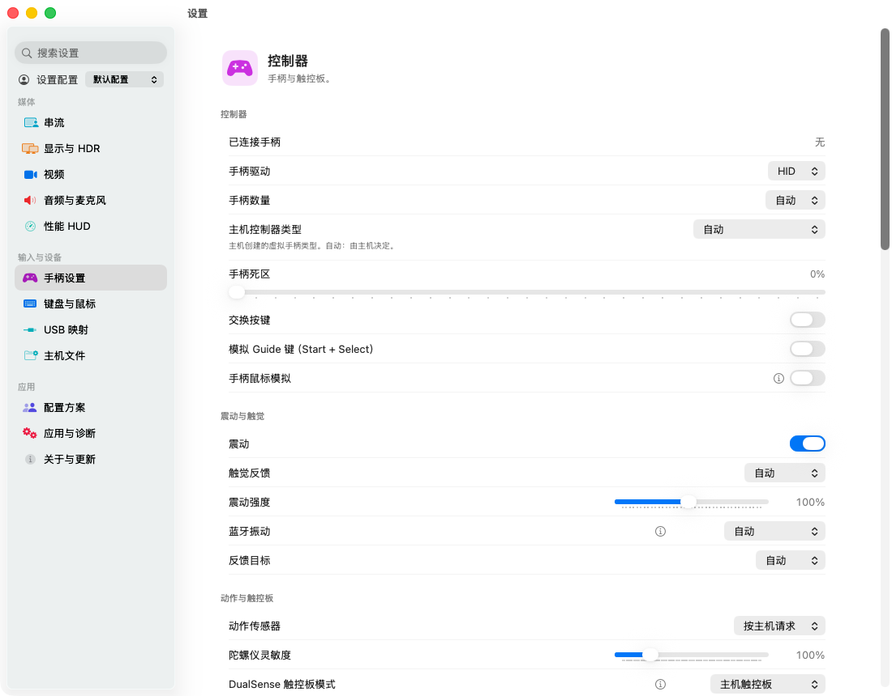
</picture>

<b>控制器</b>

</td>
</tr>
<tr>
<td width="50%" valign="top">

<picture>
  <source media="(prefers-color-scheme: dark)" srcset="readme-assets/images/settings-profiles-dark.png">
  
</picture>

<b>配置方案</b>

</td>
<td width="50%" valign="top">

<picture>
  <source media="(prefers-color-scheme: dark)" srcset="readme-assets/images/settings-more-dark.png">
  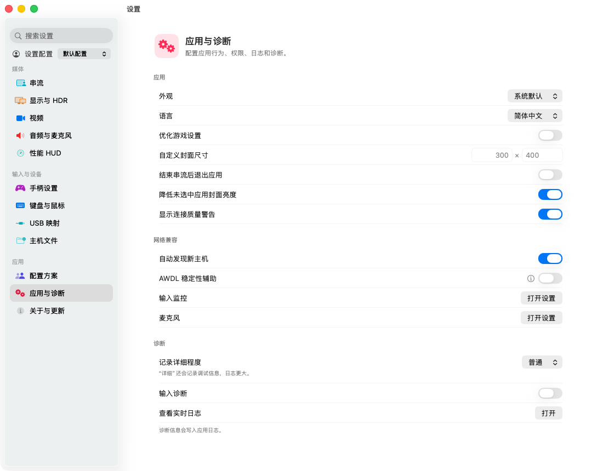
</picture>

<b>其他设置</b>

</td>
</tr>
</table>

## 连接异常

连接失败时可重试，也可直接调整分辨率、码率和连接方式。

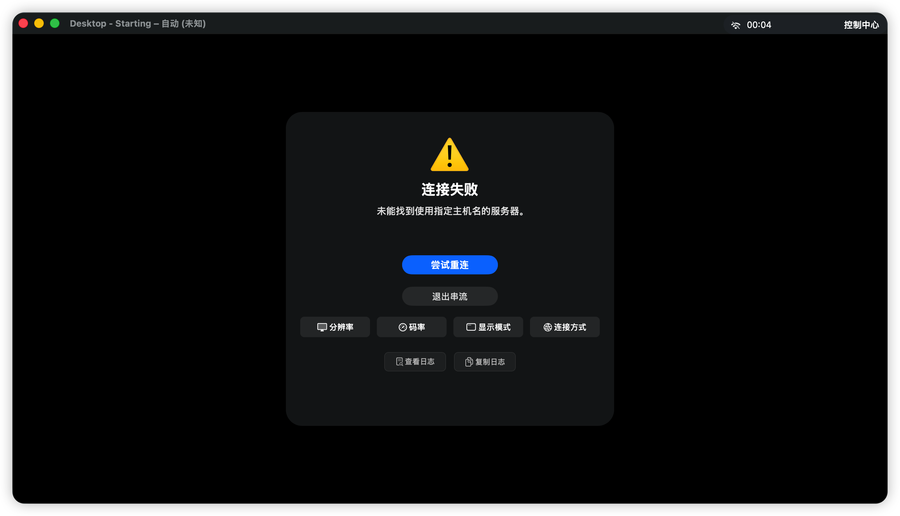

截图里的电脑名和地址是示例，游戏封面归其版权方所有。
