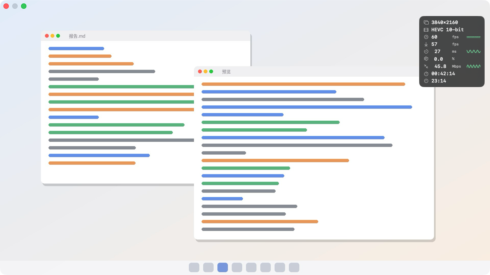
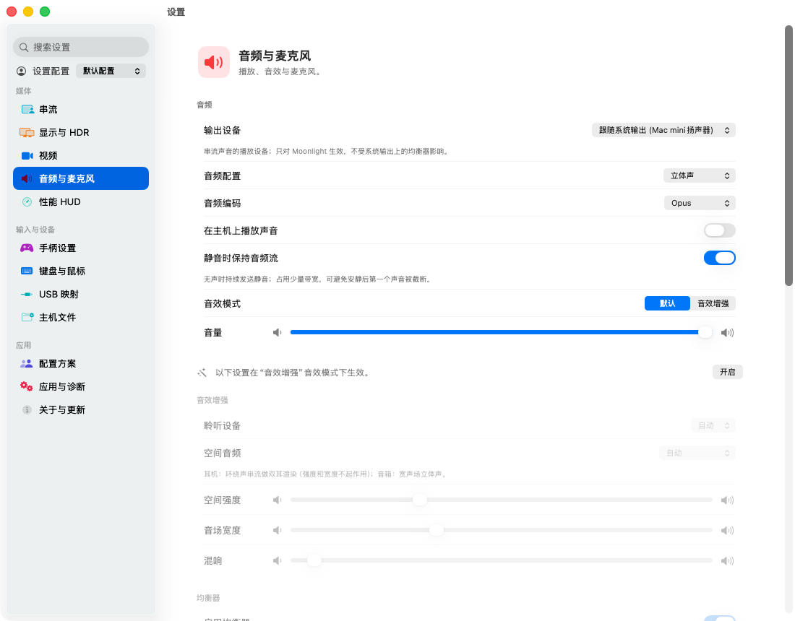
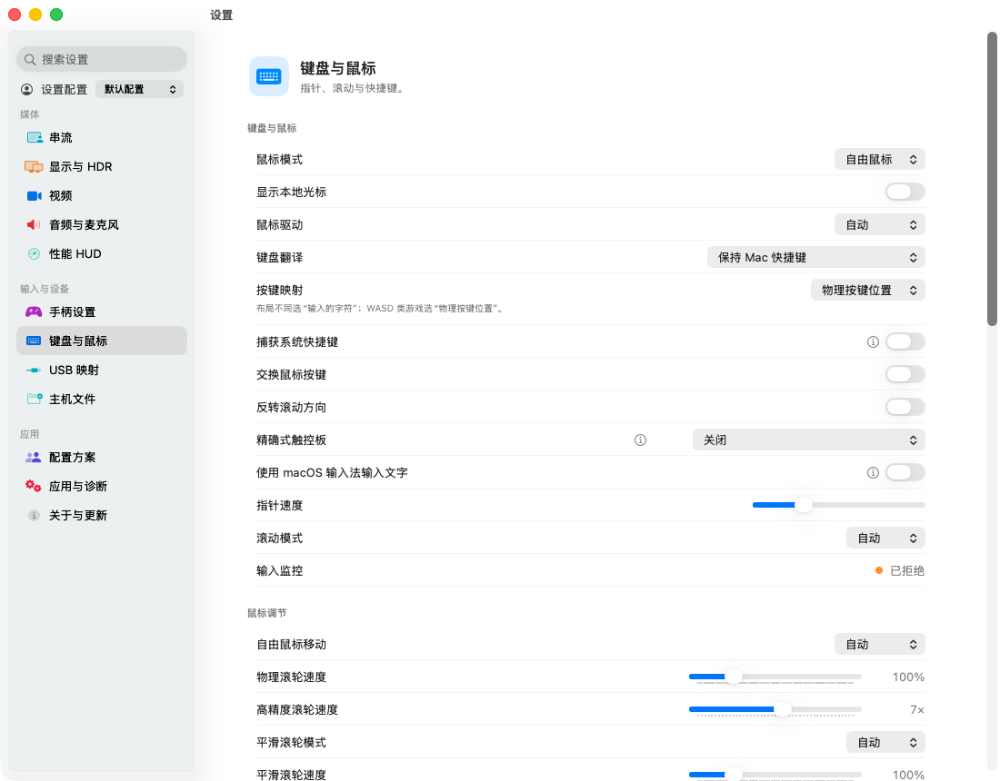
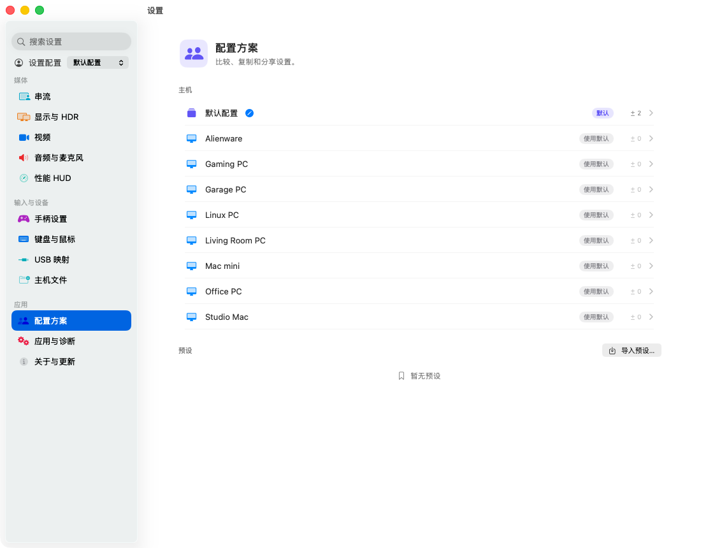

# 截图

[← 返回 README](README.md)

<picture>
  <source media="(prefers-color-scheme: dark)" srcset="readme-assets/images/home-dark.png">
  
</picture>

## 性能浮窗

提供紧凑、角落、曲线三种样式。

<table>
<tr>
<td width="50%" valign="top">

<picture>
  <source media="(prefers-color-scheme: dark)" srcset="readme-assets/images/hud-textBar-dark.png">
  
</picture>

<b>紧凑</b>

</td>
<td width="50%" valign="top">

<picture>
  <source media="(prefers-color-scheme: dark)" srcset="readme-assets/images/hud-cornerList-dark.png">
  
</picture>

<b>角落</b>

</td>
</tr>
<tr>
<td width="50%" valign="top">

<picture>
  <source media="(prefers-color-scheme: dark)" srcset="readme-assets/images/hud-chartHUD-dark.png">
  
</picture>

<b>曲线</b>

</td>
<td width="50%" valign="top">

<picture>
  <source media="(prefers-color-scheme: dark)" srcset="readme-assets/images/settings-overlay-dark.png">
  
</picture>

<b>性能浮窗设置</b>

</td>
</tr>
</table>

## 设置

可搜索到具体选项，支持手柄操作。

<table>
<tr>
<td width="50%" valign="top">

<picture>
  <source media="(prefers-color-scheme: dark)" srcset="readme-assets/images/settings-video-dark.png">
  
</picture>

<b>视频与 HDR</b>

</td>
<td width="50%" valign="top">

<picture>
  <source media="(prefers-color-scheme: dark)" srcset="readme-assets/images/settings-audio-dark.png">
  
</picture>

<b>音频与麦克风</b>

</td>
</tr>
<tr>
<td width="50%" valign="top">

<picture>
  <source media="(prefers-color-scheme: dark)" srcset="readme-assets/images/settings-keyboard-mouse-dark.png">
  
</picture>

<b>键盘与鼠标</b>

</td>
<td width="50%" valign="top">

<picture>
  <source media="(prefers-color-scheme: dark)" srcset="readme-assets/images/settings-controller-dark.png">
  
</picture>

<b>控制器</b>

</td>
</tr>
<tr>
<td width="50%" valign="top">

<picture>
  <source media="(prefers-color-scheme: dark)" srcset="readme-assets/images/settings-profiles-dark.png">
  
</picture>

<b>配置方案</b>

</td>
<td></td>
</tr>
</table>

截图里的电脑名、地址和封面都是示例。
